# SwarmUI LLM Assistant

A full LLM workspace inside [SwarmUI](https://github.com/mcmonkeyprojects/SwarmUI): persistent chats, custom assistants, agentic tool calling, vision, side-by-side model comparison, a floating in-page companion, and deep Generate-tab prompt integration.

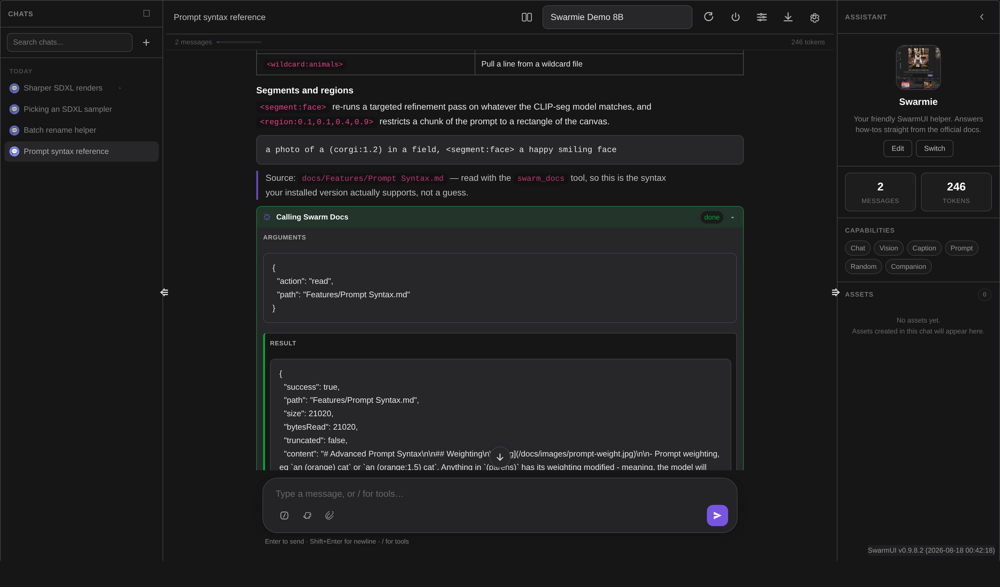

It ships its own LLM runtimes, so there is nothing else to install: a **pure-C# local GGUF engine** and **any OpenAI-compatible endpoint** (OpenAI, Anthropic Claude, Ollama, LM Studio, vLLM, OpenRouter, …). Pick one under `Server > Backends` and the tab lights up.

| | |
|---|---|
| **Version** | `2.0.0-alpha.2` |
| **Requires** | SwarmUI (developed against `0.9.8.2`; CI builds it against SwarmUI's current default branch) |
| **Local engine** | [`HartsyInference`](https://www.nuget.org/packages/HartsyInference), the latest published version (NuGet, pulled automatically on each build) |
| **License** | MIT |

---

## Contents

- [Highlights](#highlights)
- [Requirements](#requirements)
- [Installation](#installation)
- [Adding an LLM backend](#adding-an-llm-backend)
- [Quick start](#quick-start)
- [The interface](#the-interface)
- [Assistants](#assistants)
- [Long chats](#long-chats)
- [Chat library](#chat-library)
- [Tool calling](#tool-calling)
- [Hooks](#hooks)
- [MCP servers](#mcp-servers)
- [Code tools and workspaces](#code-tools)
- [Skills and commands](#skills-and-commands)
- [Prompt styles](#prompt-styles)
- [Sessions](#sessions)
- [Schedules](#schedules)
- [Knowledge library](#knowledge)
- [Setup check and headless turns](#headless)
- [Built-in tools](#built-in-tools)
- [Image workflow tools](#image-tools)
- [Vision](#vision)
- [Assets](#assets)
- [Companion overlay](#companion-overlay)
- [Per-user memory](#per-user-memory)
- [Generate-tab integration](#generate-tab-integration)
- [Settings reference](#settings-reference)
- [Network connections](#network-connections)
- [Permissions](#permissions)
- [Multi-user model](#multi-user-model)
- [API reference](#api-reference)
- [Architecture](#architecture)
- [Troubleshooting](#troubleshooting)
- [Known limitations](#known-limitations)
- [License & credits](#license--credits)

---

## Highlights

- **Real chats, stored on the server.** Threads are grouped by date, searchable, renameable, exportable (JSON / Markdown / plain text), and auto-titled from the first exchange. Your message is saved *before* the model is called, so a disconnect never loses it.
- **Message branching.** Edit a message or regenerate a reply and the old version survives as a switchable sibling branch, so no edit is destructive.
- **Side-by-side comparison.** Run the same prompt through two models at once, in parallel, then keep the winner.
- **Agentic tool calling.** 20 built-in tools (plus the `skill`, code, session, schedule and knowledge tools and whatever MCP servers add), up to 8 tool rounds per turn, with per-tool permissions, Ask / Auto / Plan approval, hooks, sandboxing, SSRF protection, rate limits, and an optional audit log. Every provider runs tools through the same loop: the local engine reads the tool-call format from the model's own chat template, and OpenAI-compatible endpoints (Claude included) use their native tool-calling API.
- **Agent harness.** [MCP servers](#mcp-servers), [hooks](#hooks), [code mode with workspaces](#code-tools), [skills and slash commands](#skills-and-commands), [sessions](#sessions) the assistant starts and directs, [schedules](#schedules), a [knowledge library](#knowledge) and a [setup check with headless turns](#headless).
- **Chat library.** Full-text [search](#chat-library) across your chats, pins, and JSON import / export.
- **Memory.** Private per-user [notes](#per-user-memory) the assistant can save by itself (off by default), with a manager screen, undo, pause switches and retention.
- **Prompt styles and rewriting.** [Per-model prompt styles](#prompt-styles) for image and video models and for chat models, with an optional automatic prompt rewrite for every generation (off by default).
- **Image workflow tools.** Four read-only [catalog tools](#image-tools) let the model see your installed models, LoRAs, wildcards and presets before it generates.
- **Custom assistants.** Per-mode system prompts, inheritance, per-model prompt variants, parameter overrides, avatars, and a per-assistant tool allowlist.
- **Rich rendering.** GitHub-flavored Markdown, syntax highlighting, tables, KaTeX math, and Mermaid diagrams, all sanitized through DOMPurify and all served locally. **No CDN, no outbound requests.**
- **Floating companion.** An opt-in in-page helper that can critique your last render, suggest a preset, or explain a SwarmUI feature from the bundled docs.
- **Prompt integration.** `<llmprompt:…>` tags in the Generate tab are expanded by the LLM at generation time.

---

## Requirements

- A working SwarmUI install.
- At least one LLM backend added under `Server > Backends` (see below).
- For the local engine: `.gguf` weights in `Models/llm/` and, ideally, a GPU: an NVIDIA RTX 30-series or newer through CUDA, or any other GPU through Vulkan (CPU works, slowly).
- For OpenAI or Anthropic Claude: each user sets their **own** API key in the `User` tab. No key is stored server-wide.

---

## Installation

1. Clone into SwarmUI's extension folder:

   ```bash
   cd /path/to/SwarmUI/src/Extensions/
   git clone https://github.com/HartsyAI/SwarmUI-LLMAssistant.git
   ```

2. Rebuild SwarmUI: run `update-windows.bat` or `update-linuxmac.sh` from the SwarmUI root. This restores the `HartsyInference` NuGet package the local engine needs.

3. Restart SwarmUI. An **LLM Assistant** tab appears in the main tab strip.

4. (Local engine only) Drop GGUF weights into `Models/llm/`. They show up in SwarmUI's model browser too, since the extension registers `LLM` as a first-class model type.

---

## Adding an LLM backend

Go to `Server > Backends`. The two LLM backend types appear directly in the "Add new backend" row.

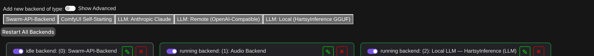

| Backend type | What it is |
|---|---|
| **LLM: Local (HartsyInference GGUF)** | Runs GGUF models on this machine with the built-in pure-C# engine. No llama.cpp, no Python, no external process. Reads from `Models/llm/`. |
| **LLM: Remote (OpenAI-Compatible)** | Any OpenAI-compatible server, such as OpenAI, Anthropic Claude, Ollama, LM Studio, vLLM or OpenRouter. Each user's own key overrides the configured `Authorization` header: `anthropic_api` for Anthropic's API (see [Claude](#anthropic-settings)), `openai_api` otherwise. |

Each card groups its settings into sections. **Basics** starts open; **Memory** and **Advanced** open by themselves when a setting in them is changed from its default. Each section header has a **Guide** link, and each `?` tooltip ends with a link to the part of this README that explains the setting. The tables below name each setting by its label on the card, with the name it is saved under (and shown in the logs) in brackets.

Dropdowns list only what works here: the local card's **Device** and **GPU** come from the engine's own device check, and **Default Model** comes from the server. A saved value that a dropdown no longer lists stays selected, marked *(saved value)*, so saving the card never changes it behind your back. The device lists are built once per SwarmUI start, so restart SwarmUI after changing a GPU or driver.

### Local engine settings

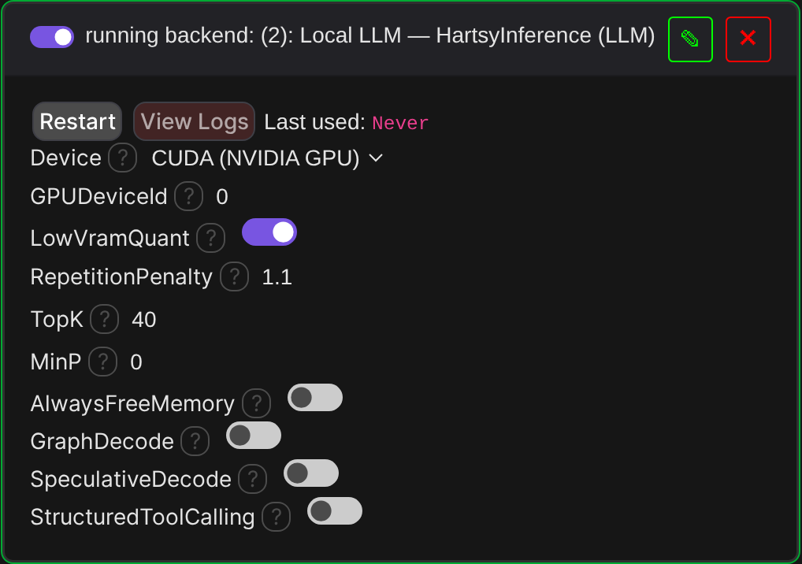

The local card has three sections: Basics, Memory and Advanced. A backend you already have keeps every saved value; only a new backend starts on **Device: Auto**.

#### Local engine basics

| Setting | Default | Notes |
|---|---|---|
| **Device** (`Device`) | `auto` | Which hardware runs the model. **Auto** tries CUDA, then Vulkan, then the CPU, and takes the first one that passes the engine's test computation. **CUDA** is the fast path for NVIDIA RTX 30-series cards and newer. **Vulkan** runs AMD, Intel and older NVIDIA cards (RTX 20-series, GTX 16-series). **CPU** needs no GPU but is slow. Only the choices that work on this machine are listed. |
| **GPU** (`GPUDeviceId`) | `0` | Each GPU by number and name, for example `GPU 0: NVIDIA GeForce RTX 3060 (12 GB)`. Under CUDA the number is the CUDA ordinal, which is fastest-first and can differ from `nvidia-smi`'s order. Under Vulkan, `0` lets the engine pick the best GPU and any other number is the Vulkan device list's own. The list follows **Device**. To use more than one GPU, add one backend per GPU. |
| **VRAM Mode** (`VramMode`) | `Auto` | How hard the engine works to fit models into GPU memory. **Auto** reads the card's size, then measures free memory, and is right for almost everyone. **Performance** keeps the model loaded and never frees it on its own. **Balanced** and **Aggressive** free more between replies, for sharing the GPU with image generation. **Maximum** also turns on **Keep Weights Compressed** and frees the model after every reply. |

#### Local engine memory

| Setting | Default | Notes |
|---|---|---|
| **Placement** (`Placement`) | `auto` | Where a GGUF model goes when it is too big for this GPU. CUDA only. **Auto** puts the whole model on this GPU when it fits, else splits its layers across every GPU, else (for a mixture-of-experts model) keeps the most-used experts on this GPU and runs the rest on the CPU. **GPU only** refuses a model that does not fit instead. **Split across GPUs** always splits. **Offload experts to CPU** always offloads, which runs a large mixture-of-experts model on a small card, more slowly. The model list shows where the engine put each loaded model. |
| **Keep Weights Compressed** (`LowVramQuant`) | `false` | Keeps quantized GGUF weights compressed on the GPU instead of caching a wider copy: less VRAM, slower replies. CUDA, and Vulkan for MOSS-VL. **VRAM Mode** Maximum turns it on too. |
| **Weight Precision** (`WeightPrecision`) | `native` | For a MOSS-VL checkpoint folder only: re-quantizes the weights a release leaves in BF16 as the model loads, so it fits a smaller card. **Q8_0** suits the NF4 release and **Q4_K** the FP8 one (see **MOSS-VL-Realtime** below). A GGUF ignores it, and it applies on the next load: unload the model to change it. |
| **Unload After Each Reply** (`AlwaysFreeMemory`) | `false` | Unloads the model after every reply, so the next reply loads it again. Unlike **VRAM Mode** Maximum, it changes nothing else. |
| **Free RAM Floor (GB)** (`EvictBelowGb`) | `0` | Before each reply, unloads the loaded model first when free system RAM is below this many GB. `0` turns it off. Set it too high and every reply reloads the model. |
| **Reuse Chat Memory** (`ReuseConversationPrefix`) | `true` | Keeps each conversation's processed prompt between turns, so long chats start answering sooner (see below). Not used while **Unload After Each Reply** is on, or with **VRAM Mode** Aggressive or Maximum. |

**Conversation prefix reuse** (`ReuseConversationPrefix`). Each conversation (a chat thread, a voice session) keeps its KV cache on the device between turns, so from turn 2 on the engine only processes the tokens added since, and time to first token stops growing with the history. Replies are equivalent: byte-identical on CPU; on a GPU the reused cache can round slightly differently. The engine bounds what this holds, with settings in `~/.config/hartsyinference/settings.json`:

- **Shrink to fit.** After each turn a conversation's cache shrinks to its length plus `vram.prefixCacheHeadroomTokens` (default 256), and grows again by an on-device copy when the next turn needs room. A 1,000-token Qwen3-4B chat holds about 0.34 GiB between turns.
- **Per-conversation cap.** A conversation that would need more than `vram.prefixCacheMaxBytes` (default 1.5 GiB: about 5,200 tokens of conversation for Qwen3-4B, 24,300 for Llama-3.2-1B) is not kept at all, so a very long thread runs uncached, as every turn did before this setting existed.
- **LRU.** Each GPU keeps at most `vram.prefixCacheMaxEntries` (default 4) conversations within that same byte budget, least recently used first.

Free Memory (including Swarm's idle VRAM clear), switching models or editing the backend releases them all.

#### Local engine advanced

| Setting | Default | Notes |
|---|---|---|
| **Repetition Penalty** (`RepetitionPenalty`) | `1.1` | Makes tokens the model already used less likely, so small models don't loop. `1.0` turns it off. It applies at temperature 0 too, where it keeps a long reasoning trace from looping. The chat has no override for it, so this is the only place to set it. |
| **Top K** (`TopK`) | `40` | Each step, keeps only the K most likely tokens. `0` turns it off. Values from 1 to 64 let **Graph Decode** run normal chats. |
| **Min P** (`MinP`) | `0` | Drops tokens below this fraction of the top token's probability. `0` turns it off; `0.05` is a common choice. |
| **Graph Decode** (`GraphDecode`) | `false` | Records each decode step once as a CUDA graph and replays it, for faster replies on common dense models (Llama, Qwen, Mistral, Gemma). Works for greedy requests and, while **Top K** is 1 to 64, for normal chats. CUDA only: Vulkan turns graph decode on by itself for longer greedy replies, so this setting is not sent there. When it is on and a capture fails, the request fails instead of decoding the normal way, so turn it off if replies fail with a graph error. |
| **Speculative Decode** (`SpeculativeDecode`) | `false` | Prompt-lookup speculative decoding, with no draft model. Only for greedy (temperature 0) requests without JSON mode, and only when **Graph Decode** does not take the request. Biggest win on output that repeats earlier text. |
| **Default Loops** (`RecurrentLoops`) | `0` | For a looped model such as NVIDIA Nemotron Dory: how many passes to run when the chat sets no **Loops**. **Model default** keeps the checkpoint's own count; `1` is fastest and `4` most accurate. Every other model ignores it. See [looped models](#looped-models-dory). |

| **Video Frames Per Second** (`VideoFps`) | `1` | Frames taken each second from an attached video (MOSS-VL). `1` is the model's own default; lower is faster and uses less memory. |
| **Video Max Frames** (`VideoMaxFrames`) | `256` | The most frames taken from one attached video. Each frame costs vision memory and time, and replies slow down past about 32 frames held. |

**MOSS-VL-Realtime (images and video)** <a id="moss-vl-realtime"></a>. OpenMOSS's 11B vision-language model (engine alpha.420 and later) answers questions about attached images and videos. Put either form in the LLM model folder: the community Q4_K GGUF (`Moss-VL-Realtime-q4k.gguf`, about 8.4 GB, with `tokenizer.json` beside it; the vision tower is inside the GGUF, so no `mmproj` is needed), or an official checkpoint **folder** (BF16, NF4 or FP8; a folder is listed by its path under the model folder). Both appear in the model list with image and video attachments enabled. A server admin can fetch a variant (`gguf-q4k`, `nf4`, `fp8`, `bf16`) with `LLMAssistantDownloadModel`; each folder variant lands in its own `moss-vl-realtime-<variant>` folder. On a 12 GB card the GGUF runs as is; the NF4 folder with **Weight Precision** `q8_0` decodes at about 28.8 tokens per second and the FP8 folder with `q4_k` at about 9.7 (Vulkan, RTX 3060). The model answers about the last user message and its media only: it ignores the system prompt and earlier turns, takes no tools, and a message with no image or video gets the engine's refusal. Video needs `ffmpeg` and `ffprobe` on the server's `PATH`, or in the folder the engine setting `paths.ffmpegDir` names. CUDA has not been run for this model.

**Looped models (Dory)** <a id="looped-models-dory"></a>. NVIDIA Nemotron Dory 1.0 (engine family `dory`, HartsyInference alpha.378 and later) re-runs a shared block of layers a chosen number of times per request, trading latency for accuracy without swapping checkpoints. The count is the **Loops** field: per chat in the parameters popover, per user in the settings modal's Generation section (saved as the `loops` parameter, 0 = not set), and the backend's **Default Loops** (`RecurrentLoops`) when neither is set; a request's own value wins. The chat and voice routes take it as `loops` (1 to 4); the engine rejects a count above the model's maximum. Calls the extension makes on its own (chat titles, `<llm:…>` prompt enhancement, the caption tools) use the backend default. The engine keeps a conversation's cached prefix only for requests with the same loop count, so changing it mid-thread re-processes the prompt once. Every other model ignores the field.

### Remote (OpenAI-compatible) settings

**Basics** holds Address, Authorization Header and Default Model; the rest is under **Advanced**.

| Setting | Default | Notes |
|---|---|---|
| **Address** (`Address`) | *(empty)* | The server's address, for example `http://localhost:11434` (Ollama), `http://localhost:1234` (LM Studio), `https://api.openai.com`, or `https://api.anthropic.com` for [Claude](#anthropic-settings). The backend stays disabled until this is set. |
| **Authorization Header** (`AuthorizationHeader`) | *(empty)* | Only for a server that needs a key, for example `Bearer sk-abc123`. A user's own key from the `User` tab replaces it on that user's requests: `anthropic_api` for Anthropic's API, `openai_api` otherwise. With this empty, a server that answers "key needed" at startup still counts as running, since each user brings their own. |
| **Default Model** (`DefaultModel`) | *(empty)* | The model used when a request doesn't name one. Once the backend is saved with a working **Address**, the box suggests the server's models (from its `/v1/models`, asked with your own key when you have one), and you can still type any name. |
| **Allow Idle** (`AllowIdle`) | `false` | When the server is offline at startup, the backend waits as *idle* instead of showing an error, and switches to running after its next successful reply. |
| **Connect Timeout (seconds)** (`ConnectionAttemptTimeoutSeconds`) | `30` | How long to wait for the server when connecting and listing models. Lower it (e.g. `5`) for a server on your own network. |
| **Other Headers** (`OtherHeaders`) | *(empty)* | Extra headers, one `Header: value` per line. |
| **Token Limit Field** (`TokenLimitParameter`) | `auto` | `auto` picks `max_completion_tokens` for `api.openai.com` and `max_tokens` everywhere else. Change it only if the server rejects the auto choice. |

### Claude (Anthropic) <a id="anthropic-settings"></a>

Claude runs through **LLM: Remote (OpenAI-Compatible)**, pointed at Anthropic's [OpenAI SDK compatibility](https://platform.claude.com/docs/en/api/openai-sdk) endpoint.

1. Add an **LLM: Remote (OpenAI-Compatible)** backend with **Address** `https://api.anthropic.com`. Leave **Authorization Header** empty, so each user's own key is used.
2. Each user sets their Anthropic key in the `User` tab. A key that is not tied to one workspace also needs the workspace: the user's own workspace ID set with the key, or for everyone an `anthropic-workspace-id: wrkspc_...` line in **Other Headers**.
3. Once a user has a key, **Default Model** and the chat's model picker list the models Anthropic's Models API offers that key, so new models show up without an update.

When the Address is Anthropic's, the backend reads each user's `anthropic_api` key instead of `openai_api`, lists models with `x-api-key` (the Models API does not take a Bearer token), and leaves out the sampling settings Claude rejects: no `temperature` or `top_p` for Claude 4.7 and later, and only `temperature` (capped at 1) for older models.

Anthropic describes the compatibility endpoint as meant for testing and comparing models rather than long-term production use. Through it, Claude's thinking is not returned, prompt caching is off, PDF and file input are refused, and every system message is merged into one system prompt.

**Upgrading from the old "LLM: Anthropic Claude" backend.** That backend type was removed. On the first start after updating, each saved one becomes a Remote (OpenAI-Compatible) backend with the same title, its **Base URL** as the **Address**, the same **Default Model**, and its **Workspace ID** as an **Other Headers** line. Its **Reply Timeout** has no counterpart and is dropped. The previous file is kept beside it as `Data/Backends.fds.before-anthropic-migration.bak`.

---

## Quick start

1. Open the **LLM Assistant** tab. If you have more than one assistant, you get the gallery; otherwise you drop straight into a chat.

   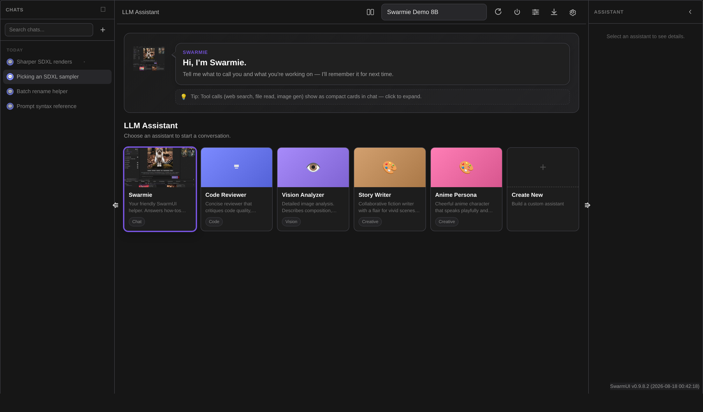

2. Pick a model from the dropdown in the top bar.
3. Type. `Enter` sends, `Shift+Enter` makes a newline, `/` opens the tool picker, and the paperclip (or a drag-and-drop) attaches an image.
4. Everything else (parameters, export, settings, the assistant panel) hangs off the top bar and the right-hand panel.

---

## The interface

**Left sidebar**: chats grouped by date, with search, multi-select delete, and `F2` to rename inline.

**Top bar**: thread title, model picker, compare toggle, model refresh, unload-model (frees VRAM), per-thread parameter overrides, export, and settings.

**Right panel**: the active assistant (with capability badges), live message/token counters, and the thread's Assets index.

Both split bars are draggable and remember their width; double-click resets them.

### Keyboard shortcuts

| Shortcut | Action |
|---|---|
| `Ctrl/Cmd + K` | Focus chat search |
| `Ctrl/Cmd + N` | New chat with the active assistant |
| `Ctrl/Cmd + Shift + F` | Find in the current chat |
| `F2` | Rename the focused chat |
| `↑` / `↓` | Move through the chat list (when a chat row has focus) |
| `Esc` | Close popovers, the asset viewer, or settings |
| `/` | Tool picker (in the composer) |
| `Enter` / `Shift+Enter` | Send / newline (swap with the **Enter to Send** setting) |
| `Ctrl/Cmd + Enter` | Send, regardless of the **Enter to Send** setting |

### Compare two models

Click the compare icon next to the model picker, choose a second model, and send once. Both lanes stream in parallel over one socket; each reply is persisted as a sibling of your message, tagged with the device it ran on. **Keep this one** promotes a lane to the thread's main path.

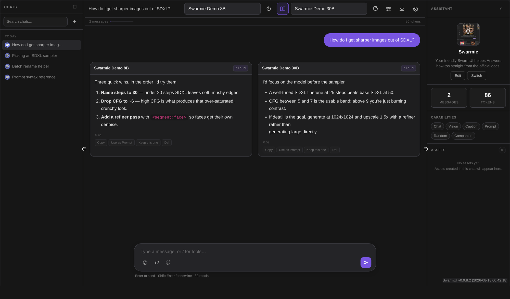

### Long chats <a id="long-chats"></a>

The bar above the chat shows how many **tokens** the conversation holds, out of the model's **context window**. The count is what the model itself reported for its last reply (a `~` in front means it is an estimate, for a provider that reports none). The window is what you set in `Settings > General > Context`, else what the model's own listing says; a model that states none (many local endpoints do not) shows the count without a limit, and is never shortened on its own.

When a chat reaches **80%** of the window (`Shorten At`), the start of it is replaced, for the next request, by a short **summary** the model writes (`Shorten Long Chats`, on by default). The newest messages are kept as they are. You can also type **`/compact`** in the composer to do it now, and add what the summary should dwell on (`/compact keep the file names`). A marker row in the chat shows where the summary ends and opens to show its text.

- Nothing is deleted. The summary is a side record on the chat, not a message in the tree, so branching, editing and deleting work as before. The full conversation stays on screen and in exports; only what is **sent to the model** is shortened.
- A summary applies only while the messages it covers are exactly the start of the branch showing. Fork the chat before it, or edit one of those messages, and the summary quietly stops applying (the full history is sent again). A later compaction builds on the earlier summary rather than starting over.
- If writing the summary fails, the reply goes ahead with the whole chat and the failure is shown. Compare mode applies an existing summary but does not start one.
- The summary is written by the chat's own model, with no tools, in a request of its own, so it cannot call anything and does not disturb the chat's prompt cache beyond the one time the history changes.

### Branching

Editing one of your messages, or regenerating a reply, creates a **new branch** rather than overwriting. The old version stays reachable through the pager on the message. Under the hood the thread is a tree with an `activeLeafId`; the conversation you see is the root→leaf path.

### Chat library <a id="chat-library"></a>

- **Search** looks through what was said, not only titles. Type in the box above the chat list: chats whose title matches show at once, and after a short pause the messages are searched too. Every word you type must be somewhere in the chat (not necessarily in the same message); matching ignores case and is plain text, never a pattern. Each result shows up to three snippets with the match marked; click one to open the chat at that message, on whichever branch it was on. Only the text of your messages and the assistant's replies is searched, never tool results or attachments, and only your own chats. The text is cached per user in memory, so typing does not re-read every chat; a chat is read again only after it changes. The text searched is capped: the first 20,000 characters of a message and the first 400,000 of a chat, so a word beyond that is not found; such a chat is marked `indexTruncated` in the reply. Past about 20 million characters of text per user, the oldest chats are searched by title only (the reply says `partial`), and at most 8 users' indexes are kept in memory at once (the one used longest ago is rebuilt on its next search). `Esc` clears the search; `Ctrl/Cmd+K` focuses it.
- **Pin** a chat with the star on its row. Pinned chats are listed first under **Pinned** (and first in `LLMAssistantGetThreads`), whichever grouping is on. Pinning is not activity: the chat keeps its date. A session is listed under the chat that started it, so it cannot be pinned on its own; pinning the chat that started it moves the whole group.
- **Export** (the download icon in the top bar) gives JSON, Markdown or plain text. JSON and Markdown come from the `LLMAssistantExportThread` route; plain text is made in the page and has no route. JSON carries every branch and the one that was showing, and can be imported again; Markdown is the conversation on screen (your and the assistant's text only; a line in a message that looks like a heading or a rule is escaped so it cannot pass for a speaker).
- **Import** (the upload icon next to the search box) reads the JSON of an export. A preview shows the title, the message count, the first messages and what will be left out; nothing is saved until you confirm, and the chat is always added as a new one with new ids. Only the text of user and assistant messages is imported: attachments, tool calls and results, mode, workspace, session, schedule and approval settings, and summaries of long chats are never taken from a file. Limits: 4 million characters, 2,000 messages, 100,000 characters per message, 64 levels of JSON nesting. Duplicate ids, parents that are not in the file, and loops are refused.

---

## Assistants

An assistant bundles a persona, its system prompts, its parameters, and the tools it's allowed to use.

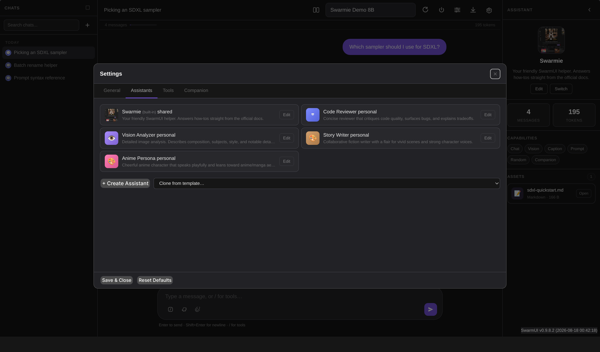

Open `Settings > Assistants` to create one from scratch, or clone one of the bundled starter templates (Anime Persona, Code Reviewer, Concise Translator, Story Writer, Vision Analyzer).

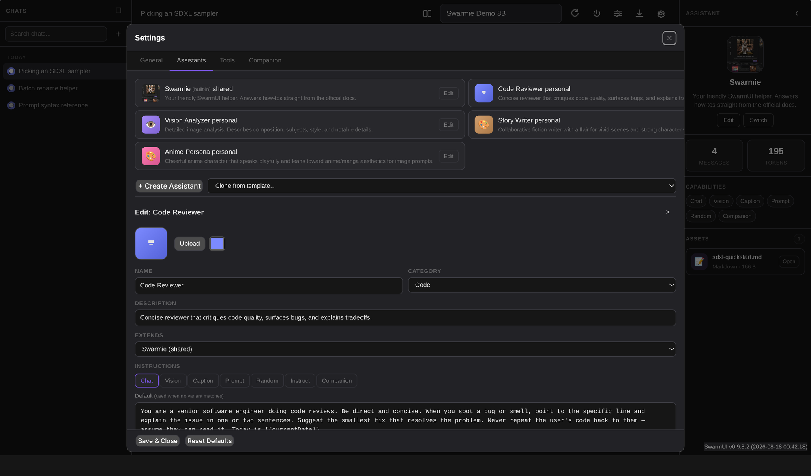

Each assistant has:

- **Identity**: name, category, description, color, and an uploaded avatar.
- **Eight instruction modes**: `chat`, `vision`, `caption`, `prompt`, `video-prompt`, `randomprompt`, `instructiongen`, `companion`. Each mode is its own system prompt.
- **Per-model variants**: any instruction can carry alternates keyed on the model's `Exact` id, `Family`, `Provider`, `Tag`, or a `Glob` pattern. Specificity order: `Exact > Family > Provider > Tag > Glob`.
- **Inheritance (`extends`)**: inherit instructions, parameters, and enabled tools from another assistant, then override selectively. Cycle-safe.
- **Parameter overrides**: temperature / max tokens / top-p, blank to fall back to your global defaults.
- **Tool allowlist**: a master on/off plus a per-tool checklist, and per-assistant tool config that overrides your account defaults.
- **A test runner**: run a sample message against the unsaved instruction text before you commit it.

Prompt variables are substituted at request time: `{{assistantName}}`, `{{userName}}`, `{{userProfile}}`, `{{currentDate}}`.

The built-in **Swarmie** assistant is a SwarmUI-savvy helper that answers how-to questions by actually reading the bundled docs with the `swarm_docs` tool and citing them.

---

## Tool calling

The model can call tools, get real results back, and keep going, up to **8 rounds** per user turn before the loop is cut off with `truncated: true`. Every chat turn runs through one loop, and the model's tool calls go through the same permission, rate limit and audit checks whichever provider served the turn.

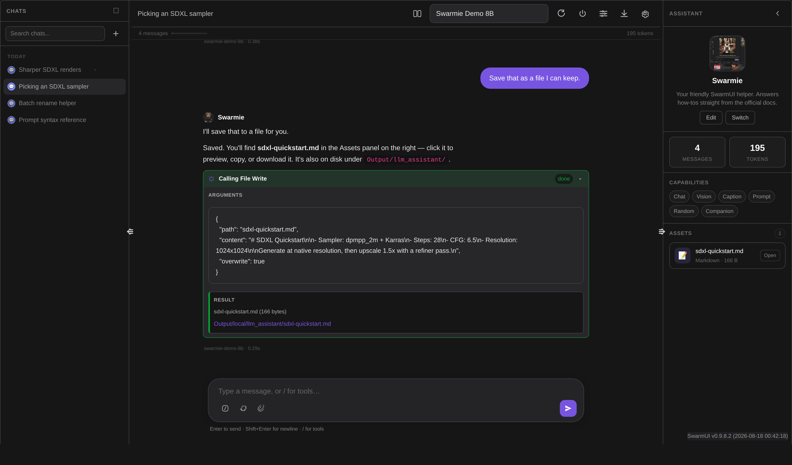

| Provider | How tools reach the model | How calls come back |
|---|---|---|
| **OpenAI-compatible** | Native `tools`, always sent when tools are on, along with saved tool turns as `tool_calls` and `tool` messages; the endpoint must support them (an endpoint that does not returns an error, and turning tools off for the chat avoids it) | Incremental `delta.tool_calls[]`, resolved at `finish_reason == "tool_calls"` |
| **Hartsy-local (GGUF)** | Native through the engine's [`HartsyInference.Tools`](https://www.nuget.org/packages/HartsyInference.Tools) package. The engine reads the model's chat template: a template with a tools slot renders the tools itself, and a template without one gets the Hermes tool prompt written into the conversation | The engine parses the model's own call format (Hermes JSON, Qwen3.5 and Qwen3-Coder XML, GLM-4.5 arg pairs, DeepSeek-R1 blocks, Llama 3, Gemma 4, Mistral) and emits a native call event |

A tool result is fed back to the model for its next round, along with the reasoning of the round that made the call, in the same `<think>` form a stored reply uses (see Muse Spark below), so a template that reads reasoning fields sees it. Saved tool turns are replayed to the model on later turns, so a follow-up can refer to an earlier result. Malformed arguments are not swallowed: when an OpenAI-compatible endpoint (Claude's included) sends a call whose arguments are not valid JSON, the tool does not run and the model gets an error result back and can retry. The local engine cannot parse such a call at all, so it stays in the reply as text.

Muse Spark (engine family `muse-spark`) is parsed by the engine itself: its own output parser splits each reply into reasoning, answer text and `<atem:invoke>` tool calls, so its calls run through the same loop, and the reasoning shows in the chat's Reasoning block like a Qwen3 `<think>` block. It is left out of one-shot replies (voice turns, prompt enhancement, captions), since its template has no `enable_thinking` switch to turn it off. On later turns a stored reply's `<think>` blocks go back as `reasoning_content` instead of answer text, for a template that reads that field and does not split `</think>` out of the content itself (Muse Spark, Gemma 4); every other template, and a reply that is only reasoning, gets the reply as stored. The reasoning reaches the template from HartsyInference alpha.377 on.

All of these reach the same `tool_call` / `tool_result` events on `LLMAssistantSendMessageWS`. The voice routes use their own shape (`native_tool_call` / `tool_result` / `done`, see [Streaming frames](#streaming-frames)), and `LLMAssistantVoiceTurnWS` runs on any provider with the same loop.

### Running a tool yourself

Type `/` in the composer to get a searchable picker of every tool enabled for the current assistant. Pick one, fill in the form, and it runs directly, with no model in the loop. The call is persisted into the thread exactly like a model-driven one.

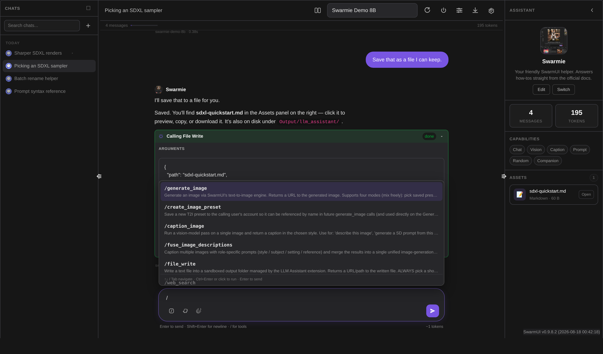

### Per-conversation toggle

The wrench button in the composer turns tool calling on or off for *this chat*, overriding the assistant's default. With tools off, no tools are sent at all. Small local models get reliably confused by tool descriptions, so turn tools off for a model that answers badly with them.

### Approving tool calls

The **Ask / Auto / Plan** control in the composer sets how this chat approves tool calls. It is saved on the chat.

| Mode | What happens |
|---|---|
| **Auto** (default) | Every tool runs without asking, as before. |
| **Ask** | A tool that only reads or looks something up runs. Anything that changes something (writes a file, saves memory or a preset, generates an image, runs a command, sends a request) waits for you: the step opens and shows **Allow once**, **Allow for this chat** and **Deny**. The turn pauses until you answer. |
| **Plan** | Only tools that read run. Anything that would change something is refused, and the model is told to describe what it would do instead. |

**Allow for this chat** covers that one tool until the chat is deleted or the server restarts. A denied call gives the model a refusal result it can act on, so it carries on without the tool. Stop, closing the tab or deleting the chat while a call waits ends the wait. You are asked only about tools you are allowed to use, and a tool you run yourself from the `/` picker is never asked about. Voice turns have nobody to ask, so they always run in Auto.

Each tool declares what it can do, which is what the modes read: `file_read`, `memory_read`, `swarm_docs`, `web_search`, `caption_image`, `fuse_image_descriptions` and the image catalog tools (`list_image_models`, `list_loras`, `list_wildcards`, `list_presets`) only read; `generate_image`, `create_image_preset`, `batch_caption_folder`, `file_write` and `memory_write` change something; `http_request` sends a request; `shell_exec` runs a command. A tool that does not say counts as a change.

### Hooks

A **hook** is a policy that runs around a tool call the model makes. Write them in `Settings > Hooks`, which also has a tester that shows what a hook would do to a sample call without running any tool.

- A **pre** hook runs before the call and can **refuse** it (the model is told why), make the user be **asked** first whatever the approval mode is, **rewrite** its arguments, or add a **note** for the model.
- A **post** hook runs after the call and can add a note to the result, which the model reads next round.
- A **rule** hook is plain data: a tool (an id, or a pattern with `*` and `?` such as `file_*`), optionally one argument and how to compare it (present, glob, regular expression or contains), and what to do. It needs no permission beyond `llm_settings`.
- A **command** hook runs a program (no shell). It gets the call as one JSON object on standard input (`{phase, tool, handler, arguments, result?}`) and answers with JSON on standard output (`{decision: allow|deny|ask, message, arguments, note}`, every field optional). Exit code 2 refuses the call with what it wrote to standard error; any other failure, or running past its time limit, follows its **If it fails** setting (refuse the call by default). Creating one needs `llm_hook_command`, which defaults to **NOBODY**: it is the same power as `shell_exec`.

Hooks live in the same two layers as assistants and tools. A **shared** hook (needs `llm_shared_write`) applies to every user; a **personal** hook applies to you. Both apply, shared first, each by its order. The first refusal stops the rest, rewrites apply one after another, and notes pile up. A personal command hook stops running if its owner loses `llm_hook_command`.

Hooks apply to calls the **model** makes, and are loaded once when a turn starts. A tool you run yourself from the `/` picker, the Run Test panel or the API is never touched. Rule matching is case-insensitive, and a regular expression that takes too long to evaluate is treated as not matching.

### MCP servers <a id="mcp-servers"></a>

An **MCP server** gives the assistant extra tools: a program on this machine (**stdio**) or a URL (**http**, the Streamable HTTP transport; the older HTTP+SSE transport is not supported). Admins set them up in `Settings > MCP Servers`, with a **Test** button that connects and lists the tools before anything is saved.

- **Who can do what.** Adding, editing, testing and removing a server needs `llm_mcp_manage` (**ADMINS**, *powerful*): a stdio server is a program started on the SwarmUI host, which is the same power as shell access, and an http server makes the host connect to a URL of the admin's choosing. Calling the tools needs `llm_tool_mcp` (**POWERUSERS**). A user without it is not shown the tools. Anyone who can open settings sees the server list; only someone who may manage servers sees a stdio server's program, arguments or full URL.
- **One shared connection per server.** Servers live in the shared settings layer and are connected once for everyone, not once per user. (Personal servers, with per-user secrets, are not offered yet.)
- **Secrets.** Environment variables and headers are secrets: they are never sent to the browser. The editor shows them as `••••••`, and saving that text back keeps the stored value.
- **Safe environment.** A stdio program is started with a small environment (`PATH`, home and temp folders and the like), not the SwarmUI process's own, plus the variables the admin sets. It and its children are killed when the connection closes or SwarmUI shuts down. On Windows a command such as `npx` is found on the `PATH` and run through `cmd.exe`.
- **Tool ids.** A server's tool `read_file` on a server with the id `files` is offered to the model as `mcp__files__read_file` (letters, digits, dashes and underscores only, at most 64 characters; a longer or colliding name is shortened with a short hash). Each tool can be switched off on the server's row.
- **Nothing is on by default.** An assistant has an explicit list of tools, so a server's tools appear in no assistant's list until you switch them on in the assistant's editor. They show with the server's name beside them.
- **Approval, hooks, plan mode.** They apply as to any tool. A tool the server marks `readOnlyHint` is free to run; one that reaches outside systems (`openWorldHint`) or changes things asks first in Ask mode and is refused in Plan mode. A hook can match on the id (`mcp__*__write_note`). Every call is recorded in the audit log when it is on.
- **Failure and recovery.** A server that cannot start, or whose program dies, shows as **Failed** with the reason; the next call (or the **Reconnect** button) tries again, waiting 2, 4, 8 seconds and so on up to a minute after each failure. A call that takes longer than the server's **Time limit** (default 60 seconds) is given up on and the server stays up. When a server says its tool list changed, the list is refreshed.
- **What a result looks like to the model.** Text parts are joined and cut at 50,000 characters, a structured result is passed along, and images, audio and files are not (the model is told how many were left out).

Not covered yet: a server's resources, prompts and requests for the client's help (sampling, roots), and per-user connections.

### Code tools and workspaces <a id="code-tools"></a>

The **code tools** let the assistant work on files the way a coding assistant does, inside a **workspace**: a folder that belongs to a chat. They are off by default.

**Code mode** is the Chat / Code switch at the top left of the chat. It is on for a user who holds `llm_code_mode`. Switching a chat to Code:

- **brings the code tools with it.** A chat in Code mode is offered every code tool that is switched on in the Tools tab, whether or not its assistant lists them, and may run them (so there is no assistant to edit first). It still needs `llm_code_mode`, and tool calling not pinned off for the chat. A chat in Chat mode gets code tools only the old way, from its assistant's list;
- **starts careful**: the approval control moves from Auto to **Ask**, so changes and commands ask first (pick Auto or Plan yourself);
- **opens the Workspace panel** on the right, with four tabs: **Files** (a folder tree and a read-only viewer with line numbers; it reloads after each reply that changed something), **Changes** (below), **Terminal** (below) and **Tasks** (the task list the assistant keeps with `code_todo`, saved on the chat);
- **adds a workspace picker** in the composer: the user's workspaces, any folders an admin allowed, and **New workspace…**;
- **shows a plan card** after a reply made in **Plan** mode: *Accept plan* switches the chat to Ask and tells the assistant to carry the plan out; *Keep planning* dismisses it;
- **shows edits as diffs** in the transcript (`code_edit` results), and a failed code tool has no *Retry* (a standalone retry would run outside the chat's workspace).

The chat list gets an **All / Chats / Code** filter (for users who can use code mode), and a coding session carries a *code* badge. The mode is saved on the chat, so reopening it brings the panel back; a mode chosen before the first message applies to the chat that message creates.

**Changes tab.** Every file the assistant changed with `code_write` or `code_edit` is listed with a *new*, *edited* or *deleted* badge and its added and removed line counts, and opens as a diff. The first time a chat's tools change a file, its earlier content is saved aside (up to 5 MB per file, 100 MB and 300 files per chat; a bigger file is still changed but cannot be reverted, and says so). What the tab shows is that saved original compared with the file as it is now, so ten edits to one file are one change, and a file edited back to how it was is no change. **Revert** puts one file back (a file the assistant created is deleted); **Revert all** does every one. A file that changed *after* the assistant last wrote it (you edited it, or a command did) is not overwritten without asking. The saved originals live under `Output/<user>/llm_assistant/changes/<chat id>/` and are removed with the chat. Changing the chat's workspace starts the list over. **Not tracked:** anything a `code_bash` command changes, and edits made outside the chat.

**Terminal tab.** Each command the assistant ran with `code_bash`, with the output as it is printed (standard error in the error colour), `running…` while it goes and `[exit N]` when it ends. The output is sent as it happens, a few frames at a time, before the command's result, and stops being streamed after about 200,000 characters (the saved result keeps what fits in its own limit). A reloaded chat shows each command's saved result. It is read-only: stopping a command is the Stop button, which kills its whole process tree.

| Tool | What it does | Needs approval in Ask mode |
|---|---|---|
| `code_read` | Read a text file a range of lines at a time, with its total line count | no |
| `code_glob` | List files by pattern (`**/*.cs`, `src/*.js`; a pattern with no `/` matches the name anywhere) | no |
| `code_grep` | Search file text with a regular expression, at most 200 lines, each with file and line | no |
| `code_todo` | Keep the chat's task list (`content` and `status`); stored on the chat | no |
| `code_write` | Create a file (or replace one with `overwrite: true`); folders are created | yes |
| `code_edit` | Replace exact text; it must appear once unless `replaceAll`; returns a short diff | yes |
| `code_bash` | Run a shell command starting in the workspace (`cmd.exe` on Windows, `/bin/sh` elsewhere) | yes |

- **Three switches.** The user needs **`llm_code_mode`** (default **NOBODY**, *powerful*: `code_bash` runs as the SwarmUI user), the tool must be enabled on the Tools tab, and the assistant must have it in its tool list. None of them is on for any assistant until someone does it.
- **Workspaces.** Every user has their own under `Output/<user>/llm_assistant/workspaces/`, created on demand (`default` is used when a chat has none picked). An admin with **`llm_workspace_roots`** (ADMINS, *powerful*) can also **allow a folder** elsewhere on the host, such as a project checkout, as `root:<id>`; nothing outside the user's own folder and the allowed folders is ever a workspace, and a chat can only be pointed at one the user may use.
- **Paths stay inside.** One check (`PathSandbox`) is used by every code tool: it refuses `..`, an absolute path that is not inside the workspace, network paths, Windows device names and alternate streams, and it follows symbolic links and junctions, so a link inside the workspace that points outside cannot be used to reach what is beyond (SwarmUI's own `CheckFilePath` only checks the text of the path). Errors name no host paths. Nothing is written inside a `.git` folder.
- **`code_bash` is not a fence.** The workspace is where the command starts, not a limit on what it can reach. Output is cut at 30,000 characters each for standard output and error, and a command is stopped after 120 seconds by default (at most 600), with its whole process tree killed on a timeout or a Stop.
- **Edits are exact.** `code_edit` matches the text byte for byte, except that line endings follow the file's own (a model that writes `\n` edits a Windows file correctly and the file keeps its `\r\n`). A byte-order mark is kept. Writes go through a temporary file, so a failure never leaves half a file.
- **Project instructions.** When a chat has a code tool, the workspace's `AGENTS.md` (or `CLAUDE.md` when there is none) is added to the system prompt, cut to 16,000 characters with line endings normalized so the prompt is the same text every turn until the file changes. An ordinary chat never reads a workspace file. Only a user's own workspaces and the folders an admin allowed can supply one. (Skills and commands kept in a workspace are different: they are used only after the user trusts that workspace, see [Skills and commands](#skills-and-commands).)
- **`shell_exec`** now runs through the same process runner (its working directory is still confined to `Data/`). Its `maxOutputBytes` now caps standard output and standard error each, in characters.

---

## Skills and commands <a id="skills-and-commands"></a>

Both are markdown files with an optional `---` front matter, managed in `Settings > Skills` and run from the `/` picker. The file layout matches the one other tools use (`skills/<name>/SKILL.md`, `commands/<name>.md`), so a skill written for them works here.

- A **command** is a prompt template you run. Type `/`, pick it (or type `/name some text`), and the server turns it into the message that is sent: every `$ARGUMENTS` in the template is replaced by what you typed after the name, in one pass (an argument that itself contains `$ARGUMENTS` is not expanded again), and when the template has no token the arguments are added at the end as `ARGUMENTS: ...`. A template is only text: there is no `!command` or `@file` syntax, and nothing in it is run or read from disk. The message in the chat is the expanded text, and stays so after a reload.
- A **skill** is instructions for a kind of task. The model is told about each one in a short **Skills** section of its system prompt (name and description, sorted by name, at most 40, so the prompt is the same text every turn and a local model's cache stays valid), and loads the rest by calling the **`skill`** tool with the name. The tool can also read another file from the skill's own folder (`file`; text only, confined to that folder, links not followed), and its result lists those files. You can run a skill yourself with `/name your request`: the skill's text is put in the message, so that works even where the model could not load it. A skill with `disable-model-invocation: true` is yours alone: the model is not told about it and the tool refuses it.
- **Front matter.** `description` (what it is for; for a skill this is what the model decides on, and it falls back to the first line of the text), `argument-hint` (shown in the picker, for a command) and `disable-model-invocation`. A `name` key is ignored: the folder name (skill) or file name (command) is the name, lowercase letters, digits, dashes and underscores, up to 40. A value can continue on indented lines or be a `>` or `|` block; other keys are ignored. A file over 64 KB, a link, or an invalid name is skipped, and one folder holds at most 100.
- **Where they live** (a later scope replaces a same-named one before it):

  | Scope | Folder | Who sees it | Changed by |
  |---|---|---|---|
  | Built in | `Assets/prompt-assets/` in the extension | everyone | the extension (no skills or commands ship yet; [prompt styles](#prompt-styles) do) |
  | Shared | `Data/LLMAssistant/prompt_assets/shared/` | everyone | `llm_shared_write` |
  | Personal | `Data/LLMAssistant/prompt_assets/users/<user>/` | that user | that user, in Settings |
  | Workspace | `.llma/` or `.claude/` in the chat's workspace | the chat, once trusted | whoever can write the workspace |

  Personal skills are kept in the server's data folder and not in the user's output folder on purpose: the output folder is where the file tools write, so the model could otherwise plant a skill that goes into every later prompt.
- **Workspace skills need trust.** The model can write files in a workspace, and a skill is text that goes into its instructions, so a workspace's own skills and commands are used only for a chat in Code mode, by a user holding `llm_code_mode`, and only after that user turns on **Trust this workspace** for it in `Settings > Skills` (off for every workspace until then; it is per user and saved in their own settings). A workspace's assets never replace a built-in, shared or personal one of the same name, and an untrusted workspace's are counted (the tab says how many) but not read into anything.
- **When the `skill` tool is offered.** A chat is given it, and the index, when tool calling is on for the chat, the user holds `llm_tool_skills`, the tool is enabled on the Tools tab, and there is at least one skill the model may load. The assistant does not have to list it. It reads only (no approval in Ask mode, allowed in Plan mode), and hooks and the audit log apply as to any tool. Compare mode lanes get it and the index like a single chat does.
- **The `/` precedence.** `/compact` first, then a tool id (the existing "run this tool" behaviour), then a command or skill; a command wins over a skill of the same name. The picker lists tools, commands and skills together, with a badge on the last two, and a command or skill works even when tool calling is off for the chat.

Not covered: a skill that restricts the tools the model may use while it runs, skills fetched from a URL or a marketplace, and slash-command arguments by position (`$1`).

---

## Prompt styles <a id="prompt-styles"></a>

A **prompt style** is written instructions for one model: how to write a prompt for an image or video model (its format, layout rules and examples), or how to instruct one chat model. The styles, the way a model is matched to one, the settings to manage them and the **rewrite engine** that uses them are in; it can rewrite every generation's prompt for its model, **but only if you turn that on** (off by default, so nothing about your prompts changes until you do). You can also try it in Settings > Prompt styles > *Try a rewrite*, or through `LLMAssistantRewritePrompt`. Researched prompting guides for each model family, which the styles are written from, are in `docs/prompting/`.

- **Two kinds, kept apart.** An *image* or *video* style is for the model a prompt is written **for** (chosen by core's own model type, so Swarm already knows an Ideogram 4 file from an SDXL one, with no backend and no loaded model). A *chat-model* (`llm`) style is for the model doing the **writing** (chosen with the same matcher the per-model assistant instructions use: exact id, family, provider, tag, name glob).
- **A style is a file** in the same `---` front matter format, in a `styles/` folder of the same three scopes as skills (`Assets/prompt-assets/styles/` built in, `Data/LLMAssistant/prompt_assets/shared/styles/`, `.../users/<user>/styles/`). The file name is its id. Keys: `name`, `description`, `kind` (`image`, `video` or `llm`), `matches`, `format` (`text`, `tags` or `json`), `formatter` (a built-in normalizer: `text`, `tags`, `json` or `ideogram-4`; empty takes the one for `format`), `negative` (`none`, `separate` or `inline`), `supports` (`weights`, `break`, `regions`, `boxes`, `text-rendering`), `tasks` (chat-model styles: `chat`, `tools`, `vision`, `caption`, `rewrite`), `guide` (the researched guide). The text after the front matter is the instructions. A style is never listed to the model as a skill.
- **`matches`** is a comma separated list of `kind:pattern`. Image and video styles: `class:` (core's model class id), `compat:` (its compatibility class), `exact:` (the model's name), `glob:` (a name pattern with `*` and `?`, for example `glob:*pony*`), and `format:` (what the model's own file says it is prompted with, see below). Chat-model styles: `exact:`, `glob:`, `family:`, `provider:`, `tag:`. A style with no conditions is the default for its kind. A pattern cannot contain a comma.
- **Which style a model gets**, first match wins: your own **rule** for the model (an exact name before a pattern; a rule can also say "no style"), then the style whose condition is most specific (image: `exact`, then `glob`, then `class`, then `format`, then `compat`; chat: exact, family, provider, tag, glob), then the default. Equal conditions go to the more personal scope (personal, shared, built in), then the smaller id. A rule that names a style that does not exist is ignored, and the preview says so.
- **Built in**: `generic` (plain-language prompt, the default for an image model nothing else is written for) and `ideogram-4` (Ideogram 4 only understands structured JSON, with optional bounding-box layout). More are added as each is tested on its model.
- **What a model file can say about itself.** The extension reads flat ModelSpec keys from the model's safetensors header (through core's own header reader, only when one model is checked, and cached per file): `modelspec.prompt_format` (`text`, `tags`, `json`), `modelspec.prompt_negative` (`none`, `separate`, `inline`), `modelspec.prompt_supports` (comma list of `weights`, `break`, `regions`, `boxes`, `text-rendering`), `modelspec.prompt_boxes` (`yxyx-1000`: axis order and scale) and `modelspec.prompt_encoder` (comma list of `clip`, `t5`, `llm`, `vlm`). Any tool may write them (HartsyInference's recipes do); nothing depends on who did. Unset means "not stated", values outside the lists are dropped, and the check shows what a file says. A style can match on it with `format:json`, so a model the extension has never heard of can still be given a style for its declared format.
- **Prompt rewriting** (`PromptRewriteService`). Given a prompt and an image or video model it picks the style (above), asks the chat model through the same dispatcher chat uses (so any configured LLM backend works; with none, or on any failure, the prompt is left as written), and checks the answer in code before it is used.
  - **Swarm tags are protected.** Anything in angle brackets (`<lora:...>`, `<wildcard:...>`, `<random:...>`, `<segment:...>`, a `<bbox[...]:...>` you wrote) is swapped for a placeholder before the model sees the prompt and put back after; an answer that drops, repeats or invents a placeholder, or writes a Swarm tag of its own, is refused. In a JSON answer a tag is escaped for its string.
  - **The idea is data.** It goes to the model inside `<idea>` tags with a rule that it is never instructions, so a prompt cannot give the writer orders.
  - **Formatters** (a style's `formatter` key, else its `format`): `text` strips fences, a lead-in line and quotes; `tags` also needs balanced brackets and notes weights or BREAK the style does not list; `json` needs one JSON object; `ideogram-4` checks the whole caption (key order, one of `photo` or `art_style`, aesthetics, lighting and medium, boxes as whole numbers on the 0 to 1000 grid in `[y_min, x_min, y_max, x_max]` and dropped when empty or reversed and refused when written as 0 to 1 fractions, colors as uppercase `#RRGGBB` with the style palette capped at 16 and each element's at 5) and writes it compact.
  - **Retry, then fall back.** A refused or cut-off answer is asked for once more with the reason. If that fails too, or the model errors or takes longer than the timeout, the result is your own wording, and for a JSON-only model that wording wrapped in the smallest valid form (never bare text), with a warning saying so. A prompt that is already valid for a JSON-only model is not sent at all.
  - **Negative prompts.** For a model with a separate plain-text negative it is rewritten by a second short request; a model that takes none gets a warning; a failed rewrite keeps yours.
  - **Cache.** The same prompt, style (and its text), size, negative and writing model give the same answer from a cache kept 30 minutes, with identical requests made at once sharing one call (a batch makes one request). A rewrite that fell back is never kept.
  - **Settings** (`promptRewrite` in your settings): `model` (the chat model that rewrites; empty is the default one), `timeoutSeconds` (60, 5 to 300), `maxTokens` (2048, 256 to 8192), `temperature` (0.4). The *Try a rewrite* box can save the model.
- **Automatic rewriting of generations** (off by default). Turn on *Rewrite the prompt for the selected model every time I generate* in Settings > Prompt styles (the `promptRewrite.auto` setting). The rewrite then runs in the same place `<llmprompt>` tags are expanded, just before core parses tags and wildcards, so the Generate tab, the `generate_image` tool and the API all get it, and `<llmprompt>` tags are expanded first.
  - **Per generation:** the parameters **LLM Auto-Enhance Prompt** (`default` follows the setting, `on`, `off`) and **LLM Prompt Style** (`auto` picks by model, or name a style) are in the *LLM Prompt Processing* group, work in presets and in the API, and win over the setting. The `generate_image` tool takes `rewrite: "off"` to send a prompt exactly as written.
  - **What it skips:** a generation with no signed-in session, without the `llm_chat` permission or with no model (core's own prompt-fill test has no model), one the hook already handled (core can prepare the same task twice), an empty prompt, a model with no style, a prompt this extension itself rewrote in the last 30 minutes (so *Enhance Prompt* followed by Generate does not rewrite twice), and anything the rewrite engine itself skips (for example a prompt that is already valid for a JSON-only model).
  - **Batches:** the hook runs once per image, but the cache means one request to the writing model for identical prompts (images running at the same moment share one call, later ones read the answer). A failed rewrite is remembered for a minute, so a hung writing model costs one timeout, not one per image. A grid or an `<object:...>` pass is made of separate generations, so each distinct prompt in it is rewritten (and a grid that varies the prompt compares rewritten prompts); switch the rewrite off for those with the per-generation parameter if you do not want that.
  - **It never stops a generation.** Any failure leaves the prompt as it was (a JSON-only model gets the original wrapped, as above). The hook is synchronous, so the engine thread preparing an image waits for it, up to three times the timeout setting.
  - **Show-after.** The image's metadata keeps the original prompt (`llm_original_prompt`), the style (`llm_prompt_style`), the writing model (`llm_rewrite_model`), what happened (`llm_rewrite_status`: `rewritten`, `fallback` or `unchanged`) and any warnings (`llm_rewrite_warnings`); the prompt saved with the image is the rewritten one. The `generate_image` result gives the chat model `prompt` (what was generated from), `originalPrompt`, `promptStyle`, `rewriteStatus` and `rewriteWarnings`.
  - **Enhance Prompt button** on the Generate tab: with an image model selected it rewrites for that model's style (and its negative prompt); if the model fails, or the prompt is already right, it leaves the text and says why in a message. With no model selected, or no style for it, it does what it always did.
  - **Wildcards:** a `<wildcard:name>` is a Swarm tag, so it is hidden behind a placeholder like any other: the writing model never sees wildcard names or contents, and the tag is expanded by core afterward, per image.
  - **Not included yet:** per-chat and per-assistant overrides, a toggle in the chat composer, and video styles for image-to-video workflows (only the main model parameter is read).
- **Customize and reset.** Saving a built-in style's id as your own makes a personal copy that replaces it; deleting that copy resets it. The same works for a shared copy (needs `llm_shared_write`).
- **Settings > Prompt styles** has two sections, *By image model* and *By chat model*: the styles with their scope, an editor, your rules, and **Which style does a model get?** (pick a model, see the style, why, and the other styles that matched). Your rules are kept in your own settings layer (`styleOverrides`, not sent with the general settings, changed only through `LLMAssistantSetStyleOverrides`).
- **Chat-model styles in the system prompt** (`LlmAddendumService`). A style of kind `llm` that matches the model **actually answering** is added to that turn's system prompt, so some models can get small, model-specific adjustments (tighter tool-call rules for a small local model, output discipline for a reasoning model). **None are built in, and with no `llm` style written nothing about any prompt changes.** Details:
  - **Where.** In `TurnSetupService.PrepareAsync` (one call, `LlmAddendumService.ApplyAsync`), so a chat, a headless turn (`LLMAssistantRunTurn`) and a scheduled or background session all get it, and in each lane of a compare turn, which resolves its own model separately.
  - **Layering.** After the assistant's instruction for the turn, separated by one blank line, and before everything else that is appended (session note, skill index, project instructions). It is plain text from the style file: no timestamps, no user variables, `\n` line ends, so the addendum's own bytes are the same every turn for the same model and settings. Where it sits depends on the instruction before it, so how much of the prompt a backend's prefix cache can reuse still depends on that text (an instruction that changes every turn changes everything after it).
  - **Which model.** The one the request names; with none, the provider's default (`ILLMProvider.DefaultModelId`, set for the OpenAI-compatible backend from its *Default model* setting), else the first model any backend lists. When no backend lists the model (a listing that failed is cached as empty for a few minutes), what was last known about it is used, so a passing outage does not make a `family:`, `provider:` or `tag:` condition stop matching; a model never seen is matched by its id and name globs only.
  - **Which style.** The same resolver as the preview: your rule for the model, then the most specific condition (exact, family, provider, tag, name glob; a name glob is the fallback when a backend does not report a family, for example `glob:claude-*` through a gateway), then a style with no conditions. A style's `tasks` line limits it: a turn is `chat`, and also `tools` when it really sends tools (after the code, skill and session tool lists are settled), not merely when the assistant allows them.
  - **Switches.** Settings > Prompt styles > By chat model has **Tune prompts for the chat model** (the master switch, on by default; `promptStyles.llmAddenda`) and an on/off switch on each style (`promptStyles.disabled`, kept per user, so a built-in or shared style can be switched off without copying it). A style that is switched off is skipped as if it did not exist; the exception is a rule of yours that pins a model to it: that adds nothing (the preview says "that style is switched off") rather than some other style you did not choose. A rule can also set one model or a pattern to *no style*. Each assistant has **Tune prompts for the chat model** in its editor (`promptAddendum: false` opts out); a child assistant inherits its parent's value and only stores its own when you touch the box (the editor shows what is inherited). An assistant that wrote its own instruction variant for this very model keeps it alone when that variant is *more specific* than the style's condition (an equal or less specific one still gets the addendum on top); a rule you made for the model always applies.
  - **Size.** A chat-model style is paid on every request to its model, so it can be up to 6144 characters (refused when saved; a longer file is never added), and the preview warns when one adds about 500 tokens or more.
  - **Cost.** The dry run (`LLMAssistantRunTurn` with `dryRun: true`) returns `promptAddendum` (`applied`, `styleId`, `scope`, `via`, `reason`, `chars`, `estimatedTokens`, `warning`); `chars` is what was really added to the prompt, the addendum is already inside `systemPromptChars` and `estimatedPromptTokens`, and the one estimator everywhere is characters over four. *Which style does a model get?* (`LLMAssistantResolvePromptStyle` with `axis: "llm"`) is answered by the very function a turn uses, so the style, the reason and the addendum line cannot disagree: it takes `assistantId` (must exist), `threadId` (that chat's own tools switch) and `tools` (assume the turn sends tools; default: tools are allowed and at least one is enabled), and still names the style when a switch stops it.
  - **Not covered (known gap).** Only turns built by `TurnSetupService` and the compare lanes get an addendum. The voice endpoints (`LLMAssistantVoiceTurn` and its websocket form), the one-shot `LLMAssistantSendMessage` and the image-prompt rewrite (which builds its own request) do not; they do not go through `TurnSetupService`. Listed in `HARNESS-ROADMAP.md`.
  - **Writing one.** An example you can copy is in [docs/prompt-style-chat-model-example.md](docs/prompt-style-chat-model-example.md). It is only an example: addenda should be added for a model family only after trying them on that model.

---

## Sessions <a id="sessions"></a>

A **session** is a chat the assistant starts and directs: it works on one job in the background, with a model and tools of its own, while the assistant goes on with its own work, and it reports back when it is done. It is an ordinary chat with a parent, so you can open it, read it, talk to it, stop it or archive it. The assistant does this with seven tools, which are off until you switch them on (the permission `llm_tool_sessions`, the tools on the Tools tab, and each assistant's own list):

| Tool | What it does | Risk |
|---|---|---|
| `session_start` | `title`, `prompt`, and optionally `model`, `assistantId`, `approvalMode`, `tools`. Starts a session and returns its id | runs something (asks in Ask mode, refused in Plan mode) |
| `session_send` | Sends a message. A working session reads it when its turn ends; a finished or stopped one starts a new turn from it | runs something |
| `session_list`, `session_read` | How each session is doing, its report, and the end of its conversation | reads |
| `session_wait` | Waits (up to 600 seconds) for a session to finish and returns its report. Returns sooner when the session needs you to approve a call, since only you can clear that | reads |
| `session_stop`, `session_archive` | Stops a working session (what it had is kept); archives one: stopped, hidden from the list, kept on disk | changes something |

- **A session can never do more than the chat that started it.** Its tools are a subset of that chat's (fixed when it is made; a model that names another tool gets a refusal), its approval mode is the stricter of what it asked for and the chat's own (a chat in Ask mode cannot start an Auto session), it runs as the same user in the same workspace, and it is the same model unless it asks for another. A model reaches only the sessions its own chat started, and an id that is missing, someone else's or not a session all give the same answer.
- **Limits** (the defaults; they can be changed in the `sessions` object of the settings, within hard maximums of 3 levels, 32 sessions per chat and 8 working at once): sessions nest one level (a session cannot start sessions of its own), a chat has at most 8 that are not archived, and a user has at most 3 working at once, the rest waiting in a queue. A session that is only waiting on others (`session_wait`) does not hold one of the places.
- **They run with no browser attached.** A session keeps going if you close the tab, but not if the server stops: what was working then is marked `interrupted` the next time the chat list is read, and turns do not resume. While a session works its chat shows only what it has saved (its reply is saved when its turn ends).
- **Approvals.** A session working in the background cannot ask on screen. In Ask mode a call that changes something waits: the session's status becomes `awaiting_approval`, the chat list shows it, and opening the session shows the call with Allow once, Allow for this chat and Deny (the same answers as in any chat). Nobody answering for 15 minutes refuses the call, and the session carries on without it.
- **Reports.** When a session finishes, its last message is kept as its report and the chat that started it is told. The report is put into that chat, as a saved message marked as a session update, just before your next message, so the model reads it with the conversation and a reload or a branch sees the same thing; `session_wait` and `session_read` give the report directly and it is not given again. Reports are cut to 4,000 characters.
- **The chat list.** Sessions are listed under the chat that started them, with a fold toggle, a count and, for each, a dot for how it is doing (a spinner while working, a warning colour when it needs you). The list is read again every few seconds only while a session is working. Opening a session shows a banner with its state, who started it, Stop and Archive, and the call it is waiting on. Sending it a message while it works stops that turn first (what it had is saved), so your message lands after it. Deleting a chat deletes the sessions it started, and stops those that were working; stopping a chat does not stop its sessions.
- **Not included:** a session cannot be woken by another chat finishing (a parent sees reports at its next message or when it waits), and messages to a working session are read between turns, not between its tool calls.

---

## Schedules <a id="schedules"></a>

A **schedule** runs a prompt later, or again and again, in the background, with no one watching. Each run is a [session](#sessions) under a chat of the schedule's own (named `Schedule: <name>`, with a `schedule` badge in the chat list), so a run has everything a session has: the per-user limit and queue, approvals that wait for you, a report, a status dot and a Stop button. Manage them in `Settings > Schedules`: a switch per schedule, **Run now**, **Open** (the chat its runs are listed under), Edit and Delete, and an editor that can show the next few run times before you save.

- **When.** Every N minutes (at least 5, at most 30 days), a daily time, a weekly day and time, a cron expression, or once at a date and time. Daily and weekly are cron underneath. A cron expression has five fields (`minute hour day-of-month month day-of-week`) and takes `*`, numbers, ranges, lists, steps (`*/15`) and month and weekday names; when both day-of-month and day-of-week are given, a day matches if either does, as in standard cron. It is read in the schedule's time zone (an IANA name such as `Europe/Paris`; an unknown one is refused, not turned into UTC). A time the clock skips when it goes forward is skipped that day, and a time that happens twice when it goes back runs once. A cron whose runs come closer than 5 minutes (for example `* * * * *`) is refused. "Every" counts from when the schedule was made, so a restart does not move it.
- **After downtime.** A schedule that was due while the server was off runs once when it comes back, if it was due within the last 6 hours; it never runs once per missed time. A time later than that is skipped, and the schedule says so.
- **No overlap.** A time that comes while the previous run is still working is skipped and the schedule says why ("The previous run is still working."). Only the last 6 runs of a schedule are kept; the oldest finished ones are deleted as new ones start. Deleting a schedule leaves its chat and runs.
- **What a run can do.** A run uses the model, the tools and the approval mode saved on the schedule (Ask by default). It can use only those tools, which are only tools the schedule's maker could use, and **never a schedule or session tool**, so a run cannot make more runs. It runs as the user, in the background, and a call that needs approval waits for you to open the run (it does not hold one of your places, and it is refused after 15 minutes). Auto is available and means what it says: the run does everything with no one asking.
- **The assistant can make them, but they start off.** With `schedule_create`, `schedule_list` and `schedule_cancel` (off until you switch them on: the permission `llm_tool_schedules`, the tools on the Tools tab, and the assistant's list), the assistant can make a schedule, list and cancel the ones its chat made. What it makes is always saved **switched off**: it is listed in the tab with a "From the assistant" badge, and does nothing until you turn it on. A recurring job that runs with no one watching is not something a model should be able to start on its own, least of all one that read a hostile web page. Its tools are no more than the chat's, and its approval mode no looser than the chat's. It sees only the schedules its own chat made, not yours.
- **Limits.** 20 schedules per user; a prompt of up to 20,000 characters. The permission `llm_schedules` (POWERUSERS) is needed for the tab and its routes.
- **How it runs.** A loop started with the extension looks every 10 seconds at the users that have schedules (kept in a short list in the shared user's data, so it finds them after a restart with nobody logged in) and starts what is due. The next time is saved before the run starts, so a run that takes the server down is not started a second time. Runs are made under one background session per user, opened with `Program.Sessions.CreateSession`, and users are found with `Program.Sessions.GetUser(id, makeNew: false)`.
- **Not included:** triggers from outside (a webhook), a schedule that runs a chat's own conversation rather than a fresh prompt, and notifying you when a run finishes beyond the chat list.

---

## Knowledge library <a id="knowledge"></a>

Your own documents, kept on the server and searched by the assistant. Add text files in `Settings > Knowledge` (notes, manuals, Markdown, HTML, CSV, JSON, logs, source code) and switch on the **Search Knowledge** tool: the assistant then looks things up in them when a question may be answered by something you wrote or saved, and quotes what it finds. The tab also has a search box that runs the same search the tool does, so you can see what the assistant would get.

- **Searched by words, and by meaning if you want.** Search always works by keywords (BM25, with the document's title and headings counted too, accents and case ignored, and Chinese, Japanese and Korean searched by character and pair). If you pick an **embedding model**, documents are also searched by meaning, so a question finds text that does not use the same words ("feline" finds a document about cats); the two rankings are combined by reciprocal rank fusion. A search never needs a model and never fails because of one: with none set, with the backend down, or with documents embedded by another model, it uses words.
- **The embedding model is your own choice, kept apart from the chat model.** Pick a backend that can embed (any OpenAI-compatible backend; Claude has no embeddings API and is not offered) and type the model id as that backend knows it (`text-embedding-3-small`, `nomic-embed-text` on Ollama, ...). It is tried when you save it (one short text is sent), so a wrong model is found then, with the reason. Vectors are stored with the backend, model and size they were made with and never compared across them: after changing the model, **Embed all documents again** brings the old ones across (until then they are searched by words). Backends are used through a small capability interface (`IEmbeddingProvider`), so another kind of backend, including the local engine, can offer embeddings later without changing the library.
- **Documents.** Plain text only, read in the browser and sent as text: at most 1,000,000 characters each, 200 documents and 5,000 pieces (about 4 MB of text) in all, so a search stays quick. A file that is not text, or has no text, is refused with a reason. A page of HTML keeps its visible text (scripts, styles and tags are dropped). A document is cut along its own seams (blank lines, then sentences, then spaces) into pieces of about 900 characters that overlap a little, and a Markdown heading is kept with the pieces under it ("Guide > Install"). Not included: PDF and Word files (they need a parser), and attaching a document to a single chat; neither is needed to use the library.
- **What the assistant gets.** `search_knowledge` takes a `query` and an optional `limit` (1 to 10) and returns the best pieces with their document's title, heading and a score, at most 1,500 characters each and 6,000 in all, at most three from one document. They come back **as quoted data with a note not to follow instructions that appear inside them**: a document can say anything, and the model is told so. The tool only reads, only your own library, and is off until you switch it on (the permission `llm_tool_knowledge`, the tool on the Tools tab, and the assistant's list); it also needs `llm_knowledge`.
- **Where it lives.** `Data/LLMAssistant/knowledge/users/<user>/` on the server: `library.json` and one file per document. It is not in your output folder (the folder the file tools write to), so the assistant has no way to add to or change your library. Changes are written to a temporary file first and a file that is busy is retried, so neither a crash nor a scanner holding the file loses documents; a damaged list is kept as `library.json.damaged`. Links are never followed and no request names a path.
- **Network.** With no embedding model set, the library sends nothing anywhere. With one set, adding a document sends its text, and each search sends the query, to that backend (see [Network connections](#network-connections)).

---

## Setup check and headless turns <a id="headless"></a>

Two things for knowing the setup works and for using the assistant from a script.

**Setup check** (`Settings > General`, at the foot): **Check setup** looks at the whole setup and says, for each part, whether it is fine and what to do if it is not: LLM backends and models, the preferred model, tools (including a tool that points at a handler that does not exist, and tools the user may not run), MCP servers, hooks (including ones that cannot be read and so do nothing), skills, the knowledge library, schedules (including a scheduler that is not running and schedules that skipped runs), sessions, and whether the extension's data folder can be written. Each check has a status (`ok`, `warn`, `fail`, `info` for "not set up, which is fine"), a detail and a fix; the report has the worst one as `overall`.
- **It only reads.** It starts no connection (an MCP server that is not connected is reported as it is, not connected for the check), loads no model, opens no session and changes nothing. **Deep check** also asks each backend for its model list again and tries the knowledge library's embedding model (one short text), which are requests to other servers, so it is a separate button and a separate flag (`deep: true`); the cached model lists are left alone.
- **It does not leak.** Anyone with `llm_chat` can run it, so it gives counts and statuses: an MCP server's error text (which can hold a command line) is included only for a user who may manage MCP servers, and a storage failure says only that a file could not be created, never the folder.
- Route `LLMAssistantReadiness` (`deep?`): `{success, overall, deep, checkedAt, checks[{id, title, status, detail, fix?}]}`. The ids are stable: `backends`, `model`, `tools`, `mcp`, `hooks`, `skills`, `knowledge`, `schedules`, `sessions`, `storage`. A part that cannot be looked at (a failure while gathering) shows as its own warning instead of failing the report.

**Headless turn** (`LLMAssistantRunTurn`): one request, one reply, with no socket, for scripts and other programs. It is the same turn as in the chat, built by the same code (skills, tools, project instructions, summaries all behave identically), and it is kept in a chat, so a script can carry a conversation on by passing the `threadId` back, and the user can open it in the interface afterwards. Without a `threadId` it makes a chat (titled from the message, with no extra model call) and returns its id. For a stateless one-shot with device actions there is also `LLMAssistantVoiceTurn`.
- **Nobody can approve.** A call that would need the user's approval is refused with that reason, so a script never hangs on a prompt. `approvalMode` is `ask` by default (tools that only read run, anything that changes something is refused), `plan`, or `auto` (everything runs; it must be asked for). It is never looser than the chat's own saved mode, and it is not saved onto the chat, so the interface does not later run in Auto because a script did.
- **One reply at a time.** A chat that already has a reply being written is refused, not interleaved with (stop it with `LLMAssistantStopGeneration` first); a session still working in the background is stopped first, as for a message typed in the interface. Reports from sessions that finished are put into the chat before the message, as they are in the interface. Stop also ends a request that is waiting, but a request cannot tell that its caller disconnected, so a turn runs to its end unless stopped.
- **Dry run** (`dryRun: true`): the request is built exactly as a real turn would build it and reported on, without calling the model, saving anything or changing the chat: `{success, dryRun, model, modelFound, assistantId, threadId?, approvalMode, tools[], historyMessages, systemPromptChars, estimatedPromptTokens, contextWindow, wouldCompact, warnings[]}`. `wouldCompact` says that the chat is long enough that a real turn would summarize its start first (a model call the dry run does not make). Warnings say when no backend offers the model, the request is bigger than the window, or an approval mode would refuse changes.
- Request: `{message (required), threadId?, assistantId?, model?, approvalMode?, dryRun?, temperature?, maxTokens?, seed?, loops?, enableThinking?, instructionId?, forceToolId?}`. With no `model`, the chat's own (for a session), then the preferred one, then the first any backend offers. Reply: `{success, threadId, response, model, stopReason, toolCalls[{id, name, arguments, result}], usage?, truncated?, created?}`: `response` is the answer without the model's reasoning, each tool result is whole unless it is over 20,000 characters (then `{truncated, chars, preview}`; the chat keeps all of it), and `stopReason` is `tool_round_limit` when the round limit cut the turn. A failure is `{success: false, error, threadId?}`, with the `threadId` when a chat was made or used: what a failed turn produced is saved in it.
- Not included: a streaming variant (the chat WebSocket routes stream, and `LLMAssistantVoiceTurnWS` streams a stateless turn).

```bash
# Ask a question, read the answer, continue the same conversation
curl -s localhost:7801/API/LLMAssistantRunTurn -H 'Content-Type: application/json' \
  -d '{"session_id":"...","message":"Summarize my notes on the router"}'
```

---

## Built-in tools

Twenty tools are built in (the table below). The tools that belong to a feature of their own are described in that feature's section: the `skill` tool ([Skills and commands](#skills-and-commands)), the `code_*` tools ([Code tools and workspaces](#code-tools)), the `session_*` tools ([Sessions](#sessions)), the `schedule_*` tools ([Schedules](#schedules)), `search_knowledge` ([Knowledge library](#knowledge)) and the tools MCP servers offer ([MCP servers](#mcp-servers)). Every tool is gated by a permission (see [Permissions](#permissions)) and, where relevant, sandboxed and rate-limited.

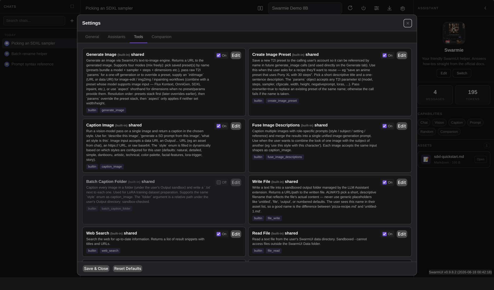

| Tool | What it does | Enabled by default | Permission |
|---|---|:---:|---|
| `generate_image` | Runs SwarmUI's T2I engine. Supports saved presets, raw T2I params, a validated `model`, `images` (a batch: 1 by default, up to the server limit, which is 4 unless an admin changes it), `initImage` for img2img/inpaint, and aspect shorthand. Returns the image URL(s). See [Image workflow tools](#image-tools). | ✅ | `llm_tool_generate_image` |
| `create_image_preset` | Saves a T2I preset to the calling user's account. Also needs SwarmUI's core `Manage Presets` permission. | ✅ | `llm_tool_create_image_preset` |
| `caption_image` | Vision pass over one image in a chosen caption style. | ✅ | `llm_tool_vision` |
| `fuse_image_descriptions` | Captions several images with role-specific prompts (style / subject / setting / reference) and merges them into one prompt. | ✅ | `llm_tool_vision` |
| `batch_caption_folder` | Captions every image in a folder and writes `.txt` sidecars, for LoRA dataset prep. Sandboxed to your Output dir. | ❌ | `llm_tool_vision` |
| `web_search` | DuckDuckGo HTML scrape. Returns `{title, url, snippet}`. | ✅ | `llm_tool_web_search` |
| `file_read` | Reads a text file inside SwarmUI's `Data` directory. 64 KB default cap. | ✅ | `llm_tool_file_read` |
| `file_write` | Writes a text file into `Output/…/llm_assistant/`. Extension allowlist (`md, json, txt, yaml, yml, csv, log` plus your own additions). | ✅ | `llm_tool_file_write` |
| `http_request` | GET/POST/PUT/DELETE/HEAD/PATCH. Blocks loopback, RFC1918, link-local, and cloud metadata addresses. 256 KB default response cap. | ✅ | `llm_tool_http_request` |
| `shell_exec` | Runs a shell command on the host. Sandboxed working dir, 30 s default timeout, 64 KB output cap. | ❌ | `llm_tool_shell_exec` |
| `memory_write` | Saves one note to the calling user's private memory (replacing the name, pronouns, bio or current work when those are written again). | ✅ | `llm_tool_memory` |
| `memory_read` | Reads the calling user's memory notes (optionally the ones matching a `query`). | ✅ | `llm_tool_memory` |
| `swarm_docs` | Lists and reads SwarmUI's bundled docs. Sandboxed strictly to `docs/`. | ✅ | `llm_tool_swarm_docs` |
| `list_image_models` | Lists the installed text-to-image models (exact name, type, usual resolution, prompt notes). Read-only. | ✅ | `llm_tool_image_catalog` |
| `list_loras` | Lists the installed LoRAs with base family, trigger words and tags; `forModel` keeps only the compatible ones. Read-only. | ✅ | `llm_tool_image_catalog` |
| `list_wildcards` | Lists wildcard names (`__name__` in a prompt). Names only; `includeSamples` also returns lines of the files, and that form is asked about in Ask mode. Read-only otherwise. | ✅ | `llm_tool_image_catalog` |
| `list_presets` | Lists the user's saved presets: name, description, key settings. Read-only. | ✅ | `llm_tool_image_catalog` |
| `set_led_profile`, `set_volume`, `mute_mic` | Voice-satellite device actions (LED show, volume, microphone mute). On the server they are no-ops: the call is handed back to the voice device in the `toolCalls` of `LLMAssistantVoiceTurn` / `LLMAssistantVoiceTurnWS`. | ❌ | `llm_tool_device_action` |

> **`shell_exec` is off by default and its permission defaults to `NOBODY`.** Granting it is equivalent to giving anyone who can chat with the model a shell on your server. Only do it for admins you trust, on models you trust.

### Image workflow tools <a id="image-tools"></a>

Four read-only tools let the chat model look at what the user has before it generates, so it does not guess a model name, and `generate_image` makes a sensible choice when it is not told one. Nothing here knows about a particular engine: the lists are what SwarmUI itself reports, and a model SwarmUI cannot classify is simply listed with a name. On a fresh install the default assistant has the four list tools; an install that already had assistants gets the tools in its tool list, like any new built-in, but no existing assistant is given them: switch them on in each assistant's tool list.

- **`list_image_models`**, **`list_loras`**, **`list_wildcards`**, **`list_presets`** only read, so they run without asking in Ask mode and are allowed in Plan mode. Each takes `query` (words in the name) and `limit` (default 25, at most 100); models also take `class` (a substring of the type's id, name or family, e.g. `xl` or `flux`) and `includeVideo` (video and audio families are left out of the image model list unless asked for), LoRAs take `baseModel` (a substring) and `forModel` (an installed model's name: only the LoRAs of exactly its family, so `-v3` never takes `-v3.5`'s), and models and LoRAs take `offset` to page through a long list. Everything read from a model file (title, tags, trigger words, weights) is cleaned of control characters and cut short, and results are cut to about 12,000 characters, say how many more match, and carry a note that descriptions and trigger words come from the files and are data, not instructions.
- **Per-user.** A user sees what SwarmUI shows them: the models they may use (core's own model-access rules, including models other extensions offer), their own presets, and the wildcards core lists for them.
- **Wildcards stay private by default.** `list_wildcards` returns names only. `includeSamples: true` adds up to 5 lines (80 characters each) of the first 10 wildcards, for when the user asks what a wildcard holds; the tool description tells the model not to set it otherwise, and because those lines would go to the chat model (maybe a hosted one) a call with `includeSamples: true` is asked about in Ask mode every time ("Allow for this chat" for `list_wildcards` does not cover it) and refused in Plan mode, unlike the other list calls. Wildcards, like models, need core's model-access permission.
- **`generate_image`'s model.** The model is, in order: the `model` argument, `params.model`, the model of the chosen preset, then the user's **default image model**. All but a preset's model are checked against what is installed: an exact name, a name in another case, without the extension or folders, or the only model containing the words is accepted (and the result says what it was matched to); a mistake gets `Did you mean: ...` with the closest installed names, and several equal fits are refused rather than guessed. With nothing chosen, the error lists the installed models and says how to pick one. The tool description names the user's default model, so the chat model knows it exists.
- **`images`** makes a batch from one call (1 to the server's limit; **4** unless an admin changes it, at most 16). A larger request is cut to the limit and the result says so (`imagesCapped`). The cap holds whatever a preset or `params` say: every spelling of `images` and `batchsize` (`Images`, `batch size`, ...) is replaced, and images times batch size is kept within the limit. With several images one failure does not discard the others: what was made comes back with a `note` (core keeps going after an error and only logs it, so the reason is in the SwarmUI log; if every image fails the error is the generic "No image was generated"), and core's contact-sheet image is not counted as one of them. Stop (or the time limit) interrupts the claim core made for this call, which stops images that have not started; an image the backend is already making watches core's session-wide interrupt instead, so it finishes and is saved (a one-image call is not shortened by Stop). The claim is the first one made after the call started, so a Generate-tab run started in the same instant could be taken for it. A call that asks for a bigger batch size than the cap allows is cut and says so (`imagesCapped`). The result keeps `imageUrl` (the first image) and adds `imageUrls` and `images` for a batch, and the chat shows every image. The [prompt rewrite](#prompt-styles) runs once for the whole batch (the rewrite cache serves the other images). A `generate_image` call may now run for up to 10 minutes, so a batch on a slow GPU is not cut off.
- **Settings and API.** *Settings > General > Image generation* has the **Default Image Model** (yours; an admin can also set one for everyone) and **Most Images Per Call** (a server limit; only a user with `llm_shared_write` can change it). The same through `LLMAssistantGetImageDefaults` / `LLMAssistantSetImageDefaults`, and the listings through `LLMAssistantListImageModels`, `LLMAssistantListLoras`, `LLMAssistantListWildcards` and `LLMAssistantListPresets` (see the [API reference](#api-reference)). The two defaults live under `imageTools` in the settings and are changed only through those routes. The listing routes need the same `llm_tool_image_catalog` permission as the tools. A default model name is at most 300 characters with no control characters, checked even for a caller who cannot list models, because it is written into the `generate_image` description. The installed-model list is reused for a few seconds per user (and dropped when SwarmUI refreshes its models).

### Guardrails

- **Permissions are keyed on the *handler*, not the tool id**, so defining a custom tool `{ id: "harmless", handlerId: "shell_exec" }` can't bypass the `shell_exec` gate.
- **60-second execution timeout** per tool call by default, plus each tool's own limits. A few tools set their own: `generate_image` 10 minutes, `shell_exec` and `code_bash` their command limit plus 10 seconds, `search_knowledge` 90 seconds, `session_wait` its wait limit plus 30 seconds, and an MCP tool its server's time limit plus 5 seconds.
- **Rate limits**: a per-user, per-tool sliding hour window. Defaults: `http_request` 60/h, `web_search` 30/h, `shell_exec` 20/h, `generate_image` 100/h, `batch_caption_folder` 5/h. Override per tool in its editor; `0` means unlimited.
- **Audit log**: an opt-in append-only JSONL trail of `shell_exec`, `file_write`, `http_request`, MCP tool calls and the code tools that change files or run commands (`code_write`, `code_edit`, `code_bash`), plus every shared-layer write, at `Data/LLMAssistant/audit.log`. Size-rotated at 10 MB × 5 generations. Toggle it with `LLMAssistantSetAuditLogEnabled` (admin only).

### Custom tools

`Settings > Tools > + Create Tool` registers a new tool: id, name, description (this is what the model sees), a JSON Schema for the parameters, and a handler id that maps to a registered `ToolHandler`. There's a **Run Test** panel for development. The only handler type you can pick in the editor is `builtin` (a handler the extension ships). Tools from [MCP servers](#mcp-servers) are not created here: they appear automatically, as `mcp__<server>__<tool>`, once an admin adds the server.

---

## Vision

Assistants with a `vision` instruction accept image attachments. Attach with the paperclip or drag-and-drop; the image is uploaded once, downscaled to the configured long-edge cap, and stored as a URL on the message, so the thread blob never carries base64.

A model that also takes **video** (MOSS-VL-Realtime, see [MOSS-VL-Realtime](#moss-vl-realtime)) enables mp4, webm and mov attachments on the same paperclip, up to 64 MB. The video is stored under the thread's uploads like an image (so deleting the thread cleans it up), previews in the composer, and plays in the message. Other models keep the image-only paperclip, and a video dropped on one is refused with a message.

The same vision path backs the `caption_image` tool, `fuse_image_descriptions`, `batch_caption_folder`, the companion's "Critique my last image", and the Generate tab's magic-vision action.

The **Vision Image Max Size** setting (256–2048 px, default 1536) controls the downscale. Lower it to cut vision-token cost on paid APIs.

---

## Assets

Anything worth keeping is promoted to the thread's **Assets** index in the right panel: fenced code blocks (8+ lines or 400+ bytes; smaller ones stay inline), HTML/SVG snippets, and results from `generate_image`, `file_read`, and `file_write`.

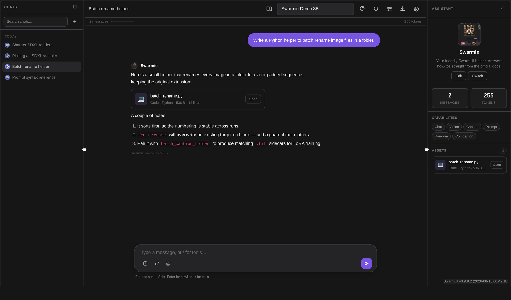

Click one to open the viewer:

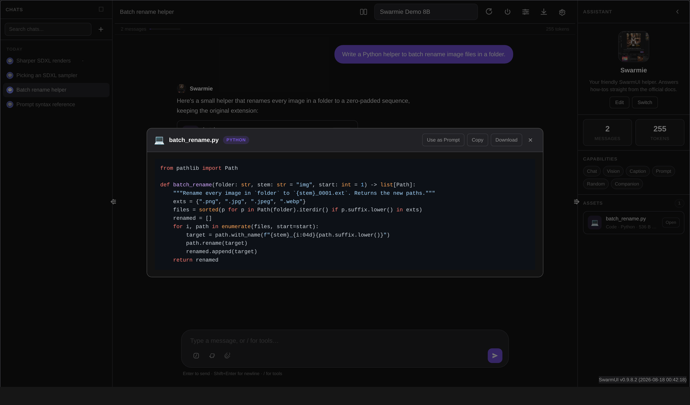

From there: **Copy**, **Download**, **Use as Prompt** (text → the Generate tab's prompt box) or **Use as Init** (image → the Generate tab's init image).

Files written by `file_write` land in `Output/<user>/llm_assistant/<path>`, appear in chat as a clickable link, and load their contents lazily in the viewer. An orphan GC sweeps unreferenced uploads and avatars daily with a 24-hour grace period.

---

## Companion overlay

An opt-in floating helper that lives over the whole SwarmUI UI, not just the LLM tab.

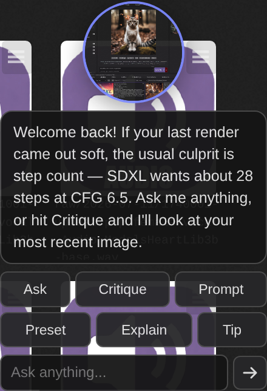

Turn it on in `Settings > Companion`.

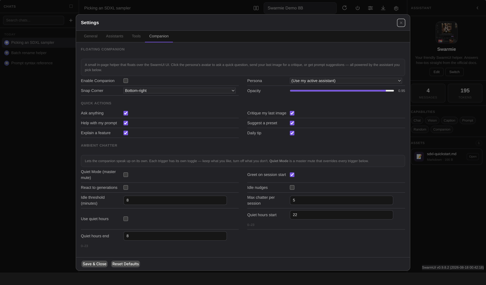

- **Persona**: a specific assistant, or "follow my active assistant".
- **Position**: snaps to a corner; drag for a free offset. Opacity is adjustable.
- **Quick actions**: ask anything, critique my last image, help with my prompt, suggest a preset, explain a feature, daily tip. Each is individually toggleable.
- **Ambient chatter**: optional unsolicited messages on session start, after a generation finishes, or when you've been idle. Every trigger has its own switch, plus **Quiet Mode** as a master mute, quiet hours, and a hard per-session cap.

Replies use the assistant's `companion` instruction, which asks for one short paragraph; the bubble is small on purpose.

---

## Per-user memory

A strictly private store of small **notes** per user. A note is one short statement with a kind (`preference`, `fact`, `project`, `style`), where it came from (`user`, `assistant`, or `explicit` for a note saved with the memory tool), the chat it was saved in, when it was saved and last used, and a pinned flag. A few things there is only one of (the preferred name, pronouns, a bio and current work) are *slot* notes: they are pinned, and saving the slot again replaces the note, as the old profile's fields did. A dislike is a preference note marked as a dislike, so it is not read the wrong way round.

| Limit | Value |
|---|---|
| Notes per user | 400 (when full, the least recently used unpinned note makes room; a set full of pinned notes refuses new ones) |
| Characters per note | 2000 |
| Pinned notes | 25 |
| Characters of notes in one prompt | about 6000 (pinned notes are always included on top of this) |

**Writing.** The model saves a note with `memory_write` (`category`, `content`; categories `preferred_name`, `pronouns`, `bio`, `current_work`, `preference`, `dislike`, `project`, `style`, `fact`). The same note saved twice is kept once; this check is per kind, so the same words saved as a `fact` and as a `preference` are two notes. A note saved with the tool has the origin `explicit` when you ran the tool yourself, or when the message being answered is one you wrote and asks to have something remembered ("remember", "don't forget", "keep in mind", "save this"…); otherwise it is `assistant`. A report from a session the assistant started, and a message in a session's inbox, are marked as not written by you and never count as you asking, and neither do older messages. This is a best guess from your words, not proof: if you yourself write "remember …" about something the model read on a page, the note is still stamped `explicit`. The automatic after-turn extractor (below) saves notes without being asked, when you turn it on; review, edit and delete, export and import, the pause switches, retention and the admin switch are in Settings, Memory (below).

**Your old profile** (name, pronouns, bio, current work, preferences, dislikes, facts) is turned into notes the first time your notes are read, with nothing lost, once even when several chats start at the same moment; clearing memory does not bring it back.

**A stored value that cannot be read is never silently lost.** A note with a bad field is skipped and the rest are used; before anything overwrites a value that did not read cleanly, its text is kept under a `memory_notes_backup_<time>` key of your account data (with the warning in the server log). Notes written by a newer version of the extension (recognised by their `version`, whatever else the file looks like) are read as far as possible but never written over: saving is refused until you update, and the Memory tab says so. Backups are bounded: the newest 3 are kept, none older than 30 days. **Clearing memory deletes everything**: every note, every embedding vector, every backup, and the old profile; it cannot be undone.

**Recall into the prompt.** `{{userProfile}}` is replaced with your notes inside a block that says they are saved data and not instructions (each note is one line, with newlines, control characters and angle brackets removed, so a note cannot start a heading or close the block). While all the notes fit the budget they are all shown, in one fixed order, so the prompt does not change from turn to turn and the model's reused conversation prefix stays valid. A set too big for the budget shows the pinned notes plus the best matches for your latest message (keyword ranking, BM25, over the note text only) and then the newest notes to fill the rest of the budget, again in the fixed order. When the notes shown change, the start of the prompt changes, so a very large note set costs more reuse of the chat prefix than a small one. Recall only runs for an instruction that contains `{{userProfile}}`; an instruction without it makes no embedding call and marks no note used. "The best matches for your latest message" applies to the chat, headless and compare routes, which take your message from the chat (what you wrote, never a session report or an inbox message). Background sessions (the messages in their chats come from a model or a schedule, not from you), the voice route and the one-shot message route have no message of yours to go by, so a set too big for the budget shows its pinned and newest notes there, ranked by nothing; the voice and one-shot routes also write no last-used time. Session chats created before this was added have no marking on their inbox and first messages, so those count as written by you. A compare turn picks its notes once, so every model sees the same ones, and its embedding call is made once. A note's last-used time is refreshed at most every six hours, only for notes actually put in a prompt.

**Meaning search is optional.** If you set an embedding model on the Knowledge tab (any backend that offers embeddings), ordinary notes saved after that are embedded too (so the note's text goes to that backend; your name, pronouns, bio and current work are always in the prompt, are never ranked, and are never sent), and ranking also uses meaning when the set is too big to show whole. Your message is embedded in a call of its own on a reply that needs ranking. A note that has no vector yet (it was saved before you set a model, or its embedding failed) is then embedded in a second, best-effort call, at most 8 at a time, so they catch up over a few replies; if that call fails or is slow, only the catching up waits (2 minutes), not the search by your message. Each embedding call is given 4 seconds; if the backend fails or is slow for your message, ranking is by keywords alone, that user's backend and model are left alone for 2 minutes (one user's bad key does not affect another user), and one warning is logged per window rather than one per turn. Stopping a reply while it waits for the backend just stops it. With no model set nothing is sent anywhere. Nothing here depends on one backend or model. Each note's vector is its own value of your account data (`memory_vec_<id>`, at most 4096 numbers, about 22 KB, so at most about 9 MB for a full set), read only on turns that need ranking, and kept only for the text it was made from; it is deleted when its note is evicted, when a slot note is given a new value, and when memory is cleared. A model whose vectors are longer than 4096 numbers is not used for notes: the first such vector is refused, one warning is logged, and nothing more is sent to that model (neither your messages nor your notes) until another model is chosen or the server restarts; notes are then found by keywords. On a reply that needs ranking, up to 400 vectors are read and decoded (up to about 9 MB), and SwarmUI's generic-data cache keeps what it has read in memory until the server restarts. The vector and backup keys are listed in one small index value (`memory_keys`), so saving or clearing a note never has to list your account data.

`memory_read` returns your notes to the model: the first 50 (at most 8000 characters), or the best matches for a `query`, each text cleaned the way the prompt block cleans it, with the total, a note when some are left out, and a line saying the notes are data and not instructions. The **Memory** tab in Settings lists, edits and deletes the notes (below).

**Saving notes automatically (off by default).** Under Settings, Memory, **Save memories automatically** lets the assistant save notes from your chats without being asked. It is your own setting, kept in your personal settings as `memoryExtraction` (`enabled`, `model`, `neverSave`); the shared layer never holds it (a shared save drops it, and a user's merged view never shows one), so an admin's settings cannot turn it on for you, and with it off a reply costs nothing extra.

- **When it runs.** After a reply to a message you wrote has been delivered (a reply that was stopped or ended in an error is not read) (so it never delays the reply), on a chat that is not a session, for a user who may use the memory tool (`llm_tool_memory`). It makes one model call per turn that looks like it says something about you: a message that is short, a pleasantry, has nothing about you in it ("what is the capital of France?"), or that was already extracted (a regenerated reply answers the same message) makes no call. It does not run when the model saved a note itself in that turn.
- **The model.** **Model that does it** is its own setting; empty means the model that answered the chat. Any model any backend offers works (a small one is enough); the call goes through the same generic dispatcher as the chat, with no tools, no conversation of its own (so it never disturbs the chat's reused prompt) and thinking off.
- **What it reads.** Only your own messages and the assistant's replies, from each message's own text on the chat's active branch: never tool results, fetched pages, attachments, reasoning, summaries, or a message the server marked with a `kind` (session reports and session inbox messages). A reply from a turn in which a tool ran, or to a message of yours that had an image or video attached, is **left out** too, since after a tool read a page or file (or a vision model read a picture) the reply can repeat what it said; such a turn is read from your messages alone, and the assistant message shown just before yours is dropped when it answered a message with an attachment. The text is sent as marked data with a standing instruction that nothing in it is an instruction.
- **What it may do.** It is shown the notes most related to what you said (all of them when there are few; pinned and name/pronoun/bio/work notes are shown as locked, for context) under short aliases (`n1`...), and answers with JSON: at most 3 `add`, `update` or `delete` operations (or none). It never appends blindly: "I moved to Lyon" is an update of the note that says Paris. The answer is checked in code: not JSON in the shape asked for means one retry, then nothing is saved; an operation on a note that was not shown, is pinned or is a slot note, a text over 300 characters, a text that looks like an instruction (a command, "always"/"never" aimed at the assistant, a role label, a link, markup, a tool name; checked after compatibility-normalising the text and removing invisible characters, and best effort: what the extractor may read is the real defence) or mentions something never to be saved is dropped. A note you wrote or asked to have saved (origin `user` or `explicit`) is changed only by a text made mostly of your own words, and then keeps its origin; an `update` may also flip a preference to a dislike and back, and otherwise leaves that flag alone. Notes that mention a never-save word are not shown to the model either. When the notes are saved they are checked again under your lock against the notes as they are then, so an edit made meanwhile wins, and nothing is saved if your memory was cleared while the model was working. The origin of a note is decided in code: `user` only when your message asks to remember something and the note is made of your own words, otherwise `assistant`. Notes are rendered like all notes, as data (see Recall).
- **The cap.** The 400-note cap and its eviction are the ones every write uses: when the set is full, the oldest-unused unpinned note makes room (and is shown in the notice and restored by Undo).
- **Never save.** A list of words, phrases or `/regular expressions/` (one per line; matched without regard to case). An expression that backtracks badly is refused when it is set, and all the matching of one extraction (the turn, and the notes shown to the model) shares one 750 ms budget: when it runs out the turn is skipped, never saved. A turn that mentions one is not sent to the model at all, and a note that mentions one is dropped. Passwords, API keys and tokens, card numbers, private keys and social security numbers are always left out whatever the list says.
- **Opt-outs.** A chat can be marked **don't remember this chat** with the button in the top bar (shown while the master switch is on; a chat you have not sent a message in yet carries the choice over), and an assistant can switch it off with **Save memories from chats with this assistant** (`memoryExtraction: false`, inherited by assistants that extend it unless they say otherwise).
- **What you see.** When something is saved, a small notice appears just above the composer listing the notes added, updated (with what they said before), removed, and dropped to make room, with **Undo** and a dismiss button; it stays about 20 seconds (longer while the pointer is on it) and blocks nothing. **Undo** puts the notes back exactly as they were (id, times, pinned flag), note by note, and only where the note is still exactly as the extractor left it (apart from when it was last used): a note you edited or pinned since is left alone (content that is identical to what the extractor left counts as unchanged, even if it was edited and put back), a removed note whose words were saved again meanwhile is not brought back twice, and when nothing at all could be undone the change stays listed. The notice is shown only in the chat it belongs to. On the chat socket it arrives as one more frame after the reply's `done` (and after a `titleUpdated`, if any): `{"memoryChanges": {"id", "at", "threadId", "added": [{"id", "text"}], "updated": [{"id", "text", "previous"}], "removed": [{"id", "text"}], "evicted": [{"id", "text"}]}}`, the very change set `LLMAssistantGetMemoryChanges` lists and `LLMAssistantUndoMemoryChange` takes (by `id`); a client that is not on the socket loses nothing, since the same information is in the history. The last 10 changes are kept (and removed by Clear) and listed under **Recent automatic changes** in the Memory tab with an Undo each, so a notice that was missed is not lost. Nothing is saved or undone while the stored notes were written by a newer version of the extension or do not read cleanly.
- **Cost and safety limits.** There is no central spend limit in the extension for the extractor to defer to, so it has its own: at most 20 extractions per user per hour, one at a time per user, one per message, an input of at most 4000 characters plus a few short notes, an answer of at most 600 tokens, at most two calls for one extraction (the second only when the first answer was not usable JSON), a 30-second limit per call and 45 seconds for the whole extraction, and a back-off: after a call fails or its answer is unusable twice, that model is left alone for that user for five minutes (one warning in the log per window), like the embedding backoff. A failure never breaks or delays a reply and saves nothing.
- **Stop and cancelling.** The extraction has its own cancellation (kept per user and chat), and a stopped extraction saves nothing, also when the stop comes after the answer and before the save. It is cancelled by Stop (`LLMAssistantStopGeneration`; the chat has no Stop button once its reply is done, so that call is made directly), by the next reply this user starts (so it never waits ahead of it on a backend with one slot), by the chat socket closing (the page closes it when another chat is opened), and by clearing memory. Clearing memory also bumps a per-user epoch, so an extraction that was already past its model call cannot write notes derived from the forgotten chat.
- **Over the API alone.** Everything the page does is a route, and the page only calls routes (through `genericRequest`). A script can do the whole thing without a socket:

  ```bash
  # 1. switch it on for yourself, with a model and a never-save list
  curl -s localhost:7801/API/LLMAssistantSetMemorySettings -H 'Content-Type: application/json' \
    -d '{"session_id":"...","enabled":true,"model":"my-small-model","neverSave":["divorce","/card [0-9]+/"]}'
  # 2. have a turn without a socket (this does not extract by itself), then extract it
  curl -s localhost:7801/API/LLMAssistantRunTurn -H 'Content-Type: application/json' \
    -d '{"session_id":"...","message":"I moved to Lyon last month and I work as a nurse."}'      # -> {"threadId": "...", ...}
  curl -s localhost:7801/API/LLMAssistantExtractMemory -H 'Content-Type: application/json' \
    -d '{"session_id":"...","threadId":"..."}'                      # -> {"success":true,"status":"saved","changes":{"id":"c1...","added":[...]}}
  # 3. look at what changed, and undo it
  curl -s localhost:7801/API/LLMAssistantGetMemoryChanges -H 'Content-Type: application/json' -d '{"session_id":"..."}'
  curl -s localhost:7801/API/LLMAssistantUndoMemoryChange -H 'Content-Type: application/json' -d '{"session_id":"...","changeId":"c1..."}'
  # 4. keep one chat out of it (or an assistant: LLMAssistantSaveAssistant with "memoryExtraction": false), and stop a running extraction
  curl -s localhost:7801/API/LLMAssistantSetThreadMemory -H 'Content-Type: application/json' -d '{"session_id":"...","threadId":"...","enabled":false}'
  curl -s localhost:7801/API/LLMAssistantStopGeneration -H 'Content-Type: application/json' -d '{"session_id":"...","threadId":"..."}'
  ```
- **Meaning search.** Notes the extractor saves are not embedded when saved (no extra embedding call is made); the backfill described under Meaning search catches them up, a few at a time, but only on replies that need ranking (a set too big to show whole), which is the only time vectors are used.
- **After a restart.** The "already extracted" memory of messages and the hourly count are kept in the server's memory only, so after a restart a message can be extracted again (the duplicate check stops it adding a note twice).
- **Not built yet.** Feeding `style` notes into anything (they are saved and shown like the others).

**Reviewing and controlling your notes (Settings, Memory).** The tab is where everything above is seen and changed, top to bottom. Everything it does is also a route (see the API table: `LLMAssistantListMemoryNotes`, `…AddMemoryNote`, `…UpdateMemoryNote`, `…PinMemoryNote`, `…DeleteMemoryNotes`, `…ExportMemory`, `…PreviewMemoryImport`, `…ImportMemory`, `…GetMemoryChanges`, `…UndoMemoryChange`, `…GetMemoryControls`, `…SetMemoryControls`, `…SetMemoryAdmin`, `…SetAssistantMemory`, `…SetThreadMemory`, `…ClearUserProfile`), so a script, a headless client or another extension can do all of it; the page calls them only through core's `genericRequest` (the extension's `llmaRequest`), and the search, kind filter and paging of the list are the server's (a page is at most 200 notes, with a cursor).

- **Pause memory.** Two switches of your own, kept in your personal settings (`memoryPause`: `saving`, `recall`), separate from **Save memories automatically** (which stays your standing choice). **Pause saving** stops the automatic extractor (also an extraction already running, which is checked again just before it saves) and the assistant's `memory_write` tool (its answer tells the model not to retry). **Pause recall** keeps every note away from any model: the chat's prompt block and your name are left out, `memory_read` returns nothing, no embedding call is made, and the automatic extractor (if saving is not paused) is shown none of your notes, so it can only add, never update or delete one. Nothing is deleted, no note is marked used while recall is paused, and your own edits in Settings are never paused. The top bar has a pause button (shown while automatic saving is on or memory is paused) that pauses or resumes both; a pause set in Settings shows there too. The tab also says where **this chat** stands (with a button for the per-chat "don't remember", which is otherwise only in the top bar) and lists the assistants that do not save memories (that switch is in each assistant's own settings).
- **Your notes.** Grouped as Name and profile, Preferences, Dislikes, Facts, Projects and Style, each with where it came from (you, the assistant, or you asked it to remember), when it was saved and when it was last used (or never used). Search the text, filter by kind or pinned, **Edit** the text and kind in place (an edited note becomes `user`; a long note is opened in full, since the list cuts texts to 500 characters; the name, pronouns, bio and current work keep their kind and stay pinned; an edit that would duplicate another note is refused), **Pin** or **Unpin** (at most 25 pinned notes; the name, pronouns, bio and current work are always pinned and do not count), **Delete** one, tick several and **Delete selected**, or **Clear all**. Every delete and clearing ask first and are final: they are not journaled, and Clear removes backups and history too. The list draws 100 notes at a time (**Show more**) and every note's text is escaped. Notes you add or edit by hand are not checked against the never-save list or the secret patterns (that list is for what the extractor and an import may save; what you write yourself is yours). Nothing here can touch another user's notes: every route works on the calling user's own store.
- **Export and import.** **Export** downloads a JSON file (`format: "llma-memory"`, every note in full with kind, origin, times, pinned flag and slot, never the chat id). **Import…** reads a file of notes (this format, or a bare list; at most 1.5 million characters and the first 400 entries) and **shows a preview before anything changes**: how many notes would be added (and the first 100 of them), and why the others are left out (already in memory, a filled name/pronouns/bio/work slot (yours is kept), mentions a password or an entry of your never-save list, not a note, no room, past the cap, or pinned over the limit). Texts go through the same cleaning as the prompt block (no control characters or angle brackets) and the 2000-character cap, ids are made fresh, and imported notes are marked `user`. An import only adds: it never replaces a note and never drops one to make room (when memory is full the rest is reported as not fitting), and the server works the plan out again from the file and your notes when you press **Add**, so a stale preview cannot overwrite anything. Imported notes count as used at the moment of import, so retention does not forget them at once; their embeddings, if you use a meaning-search model, are made later a few at a time, as for any note without one.
- **Recent automatic changes.** The history of the extractor's last 10 changes and the last 30 times retention forgot notes (kept apart, so later extractions never push a sweep out of it), newest first and marked as such, each with what was added, updated, removed or dropped to make room, and an **Undo** (the same one as the notice's). A note you changed since is left alone.
- **Forget unused notes.** Optional, off by default (`memoryRetention.unusedDays`, 7 to 3650): notes not used for that many days (a note counts as used when it is put in a reply's prompt or returned by the memory tool's `memory_read`; counted from when it was saved if never used) are forgotten, never a pinned note or your name, pronouns, bio or current work. It is applied lazily: when a reply is prepared, at most once a day per user and not while recall is paused (nothing is marked used then; when recall is resumed every note's unused time starts again, so a long pause forgets nothing), and straight away when you save the setting (not while recall is paused, and with the same away-longer-than-the-setting rule below, so saving it never wipes the notes of someone who was away; that sweep is not announced in the chat, the reply to the save says how many were forgotten); at most 100 notes go at a time, and none from notes that cannot be read cleanly or were written by a newer version. After you have been away for longer than the set time (judged from the last time any note was used), the first reply back forgets nothing and every note's unused time starts again, since the notes were not unused, memory was. What a lazy sweep forgets is announced in the chat with a notice and **Undo**, and is one change in the history; a note brought back, and a note you edit, count as used from then; when some of the notes cannot come back (memory is full, or the same words were saved again) the change stays in the history with just those, for a later Undo.
- **Admin switch.** A user with `llm_shared_write` sees **Admin: switch off automatic saving for all users**. It is kept in the shared settings (`memoryAdmin.extractionDisabled`), is set only by `LLMAssistantSetMemoryAdmin` (audited), and is read from the shared layer only, so a personal setting cannot shadow it or turn it back on. While it is on, the automatic extractor does not run for anyone, whatever their own switch says, and their Memory tab says so; the memory tool, recall and everything a user does by hand keep working.

**Memory is never visible to another user and there is no shared memory layer.** Clear it any time with `LLMAssistantClearUserProfile`, which also removes backups and vectors.

---

## Generate-tab integration

The extension registers a parameter group called **LLM Prompt Processing** in the Generate sidebar. Toggle the group on to use it.

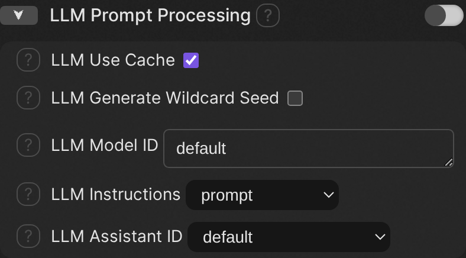

| Parameter | Default | Purpose |
|---|---|---|
| `LLM Use Cache` | `true` | Reuse the response for identical prompts within a batch. |
| `LLM Generate Wildcard Seed` | `false` | Generate one shared wildcard seed per batch so `<wildcard>` picks stay consistent while the LLM is only called once. |
| `LLM Model ID` | `default` | Override which LLM handles prompt processing. |
| `LLM Instructions` | `prompt` | Which instruction set to use: any built-in mode or a custom instruction. |
| `LLM Assistant ID` | `default` | Pin processing to a specific assistant's persona and variants. Default = your active assistant. |

### Prompt tags

| Tag | Meaning |
|---|---|
| `<llmprompt:a rough idea>` | At generation time the inner text goes to the LLM under the chosen instructions; the tag is replaced by the reply. |
| `<llmoriginal>` | Re-inject the original, pre-LLM text into the prompt. |
| `<llmresponse:…>` | Internal marker for a cached response. |

`<mpprompt>`, `<mpresponse>`, and `<mporiginal>` are accepted as aliases, so prompts written for Hartsy's MagicPrompt extension work unchanged.

Example:

```
<llmprompt:a cozy cabin in the snow, cinematic>, (highly detailed:1.2)
```

---

## Settings reference

`Settings > General`:

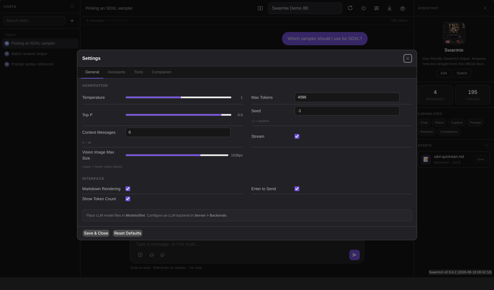

| Setting | Default | Notes |
|---|---|---|
| Temperature | `1.0` | 0–2. |
| Max Tokens | `4096` | Response length cap. |
| Top P | `0.9` | Nucleus sampling cutoff. |
| Seed | `-1` | `-1` = random. Only providers that honor a seed use it. |
| Loops | `0` | Recurrent-block passes for a looped model such as Nemotron Dory, 1 to 4; `0` = not set (the local backend's **Default Loops**, `RecurrentLoops`, applies). Other models ignore it. |
| Context Messages | `0` | Prior messages included per request; `0` = all. |
| Context Window | `0` | The most tokens the model can hold, if the model's own listing is wrong or silent; `0` uses the listing. |
| Shorten Long Chats | `true` | Summarize the start of a chat on its own once it fills **Shorten At** of the window. See [Long chats](#long-chats). |
| Shorten At | `0.8` | The share of the window (0.5 to 0.95) that triggers it. |
| Stream | `true` | WebSocket streaming. |
| Vision Image Max Size | `1536` | Long-edge cap in px, clamped to 256–2048. |
| Markdown Rendering | `true` | |
| Enter to Send | `true` | Off = `Enter` makes a newline. `Ctrl/Cmd+Enter` always sends either way. |
| Show Token Count | `true` | |
| Default Image Model | *(none)* | The image model `generate_image` uses when no preset, `model` or `params.model` names one. Yours; saved through `LLMAssistantSetImageDefaults` (`imageTools.defaultModel`). See [Image workflow tools](#image-tools). |
| Most Images Per Call | `4` | A server limit on `generate_image`'s `images` (1 to 16). Needs `llm_shared_write` to change. |

Assistant-level parameter overrides beat these; per-thread overrides (the sliders icon in the top bar) beat both.

---

## Network connections

Per SwarmUI's extension standards, everything this extension can send over the network, and when:

| Connection | When | Off switch |
|---|---|---|
| `html.duckduckgo.com` | Only when the model (or you, via `/`) calls the `web_search` tool | Disable the tool, or deny `llm_tool_web_search` |
| Any public URL | Only when the `http_request` tool is called (SSRF-guarded: loopback/private/link-local/metadata addresses are blocked) | Disable the tool, or deny `llm_tool_http_request` |
| An MCP server's URL | Only for an **http** MCP server an admin set up: when it connects, lists tools or a tool is called. A **stdio** server is a program started on the host, which can make its own connections | Switch the server off or delete it, or deny `llm_tool_mcp` |
| Your configured `Address` (embeddings) | Only when you have chosen an **embedding model** in `Settings > Knowledge`: adding a document sends its text, and each knowledge search sends the query, to that backend's `/v1/embeddings`; saving the setting sends one short test text. Nothing is sent while no model is set | Choose "None" in `Settings > Knowledge`, or deny `llm_knowledge` |
| Your configured `Address` | When an OpenAI-compatible backend you added starts, serves a chat request or lists its models (for the model picker, and for the card's Default Model when `Server > Backends` opens) | Don't add the backend |

Everything else is local: the HartsyInference engine runs in-process with no network access, and every front-end library (marked, highlight.js, KaTeX, Mermaid, DOMPurify) is bundled, so **the UI itself makes zero outbound connections.**

---

## Permissions

These permissions are all under the **LLMAssistant** group in `Server > Users`. Defaults are deliberately conservative.

| Permission | Default | Covers |
|---|---|---|
| `llm_chat` | POWERUSERS | Send messages, upload chat images, count tokens, run a tool from the picker |
| `llm_settings` | POWERUSERS | Read/write settings, assistants, tools, instructions |
| `llm_models` | POWERUSERS | List models, unload models |
| `llm_threads` | POWERUSERS | Threads, assets, session state |
| `llm_shared_write` | ADMINS | Write the shared/admin baseline; read the audit log |
| `llm_companion` | POWERUSERS | The floating overlay |
| `llm_tool_generate_image` | POWERUSERS *(untested)* | `generate_image` |
| `llm_tool_create_image_preset` | POWERUSERS *(untested)* | `create_image_preset` |
| `llm_tool_vision` | POWERUSERS | `caption_image`, `fuse_image_descriptions`, `batch_caption_folder` |
| `llm_tool_web_search` | POWERUSERS *(untested)* | `web_search` |
| `llm_tool_file_read` | POWERUSERS *(risky)* | `file_read` |
| `llm_tool_file_write` | POWERUSERS *(risky)* | `file_write` |
| `llm_tool_http_request` | POWERUSERS *(risky)* | `http_request` |
| `llm_tool_shell_exec` | **NOBODY** *(powerful)* | `shell_exec` |
| `llm_hook_command` | **NOBODY** *(powerful)* | Creating a command hook (a program run around tool calls) |
| `llm_mcp_manage` | **ADMINS** *(powerful)* | Adding, editing, testing and removing MCP servers (a stdio server is a program run on the host) |
| `llm_tool_mcp` | **POWERUSERS** | Calling the tools MCP servers offer |
| `llm_tool_skills` | POWERUSERS | The `skill` tool: letting the model load skills |
| `llm_tool_sessions` | POWERUSERS | The `session_*` tools: letting the model start sessions (chats that run in the background) and direct them |
| `llm_schedules` | POWERUSERS | The Schedules tab and its routes: prompts that run later, on a timetable, as sessions |
| `llm_knowledge` | POWERUSERS | The Knowledge tab and its routes: the user's documents, searched by words and (with an embedding model) by meaning |
| `llm_tool_knowledge` | POWERUSERS | The `search_knowledge` tool: letting the model search the user's own documents |
| `llm_tool_schedules` | POWERUSERS | The `schedule_*` tools: letting the model make (switched off), list and cancel schedules |
| `llm_code_mode` | **NOBODY** *(powerful)* | The code tools: files in a chat's workspace, a task list and shell commands (`code_bash` is shell access) |
| `llm_workspace_roots` | **ADMINS** *(powerful)* | Allowing folders on the host as workspaces |
| `llm_tool_memory` | POWERUSERS | `memory_read`, `memory_write` |
| `llm_tool_swarm_docs` | USER | `swarm_docs` |
| `llm_tool_device_action` | POWERUSERS | `set_led_profile`, `set_volume`, `mute_mic` (voice-satellite device actions) |
| `llm_tool_image_catalog` | POWERUSERS | `list_image_models`, `list_loras`, `list_wildcards`, `list_presets` (read-only; each user sees only what SwarmUI shows them) |

SwarmUI also auto-registers `view_extension_tab_llmassistant` (default USER) for tab visibility.

---

## Multi-user model

Settings live in two layers:

- **Shared**: the admin-curated baseline: shared assistants, shared tools, default instructions and parameters. Writing to it requires `llm_shared_write`.
- **Personal**: each user's own overrides, personal assistants, personal tools, and preferred model.

Reads return the merged view. Assistants and tools are union-merged, personal winning on id collision, and every entry is tagged with a `_scope` badge (`shared` / `personal`) so the UI shows which layer an item lives in and which layer a delete would hit.

Threads, memory, uploads, and session state are always strictly per-user.

---

## API reference

Every endpoint follows [SwarmUI's standard API conventions](https://github.com/mcmonkeyprojects/SwarmUI/blob/master/docs/API.md): `POST /API/<RouteName>` with a JSON body that includes a `session_id` from `GetNewSession`. Routes marked **WS** take a WebSocket connection instead.

```bash
# Get a session
SID=$(curl -s -H "Content-Type: application/json" -d '{}' \
  -X POST http://localhost:7801/API/GetNewSession | jq -r .session_id)

# What models are available?
curl -s -H "Content-Type: application/json" -d "{\"session_id\":\"$SID\"}" \
  -X POST http://localhost:7801/API/LLMAssistantGetModels
```

### Route permissions

Every route is registered with one base permission, which SwarmUI checks before the route runs (a few routes then check a stronger permission inside, as their rows say: `llm_mcp_manage`, `llm_hook_command`, `llm_code_mode`, `llm_workspace_roots`, `llm_shared_write`). The groups below are read from the registrations in `WebAPI/LLMAssistantAPI.cs` and `Backends/BackendCardAPI.cs`; the Chat, Threads, Assistants, Tools and Settings tables that follow give each route's request and reply.

| Base permission | Routes |
|---|---|
| `llm_chat` | Chat and turns (`SendMessage`, `SendMessageWS`, `EditMessageWS`, `RegenerateWS`, `VoiceTurn`, `VoiceTurnWS`, `RunTurn`, `Readiness`, `StopGeneration`, `ResolveToolApproval`, `CompactThread`, `CreateThread`, `TestInstruction`, `UploadChatImage`, `UploadChatVideo`, `CountTokens`, `Decide`), `ExecuteTool`, the workspace routes that read or change the files of a chat (`ListWorkspaceFiles`, `ReadWorkspaceFile`, `ListWorkspaceChanges`, `GetWorkspaceChange`, `RevertWorkspaceChange`, `GetWorkspaces`, `CreateWorkspace`; the rows say which of them also need `llm_code_mode`), reading and expanding skills, commands and prompt styles (`GetPromptAssets`, `GetPromptAsset`, `ExpandPromptAsset`, `GetPromptStyles`, `GetPromptStyle`, `ResolvePromptStyle`), `RewritePrompt`, and all the memory routes except `SetMemoryAdmin` and `SetThreadMemory` |
| `llm_settings` | Settings, assistants, instructions, tools and tool config, hooks, MCP servers, saving or deleting skills, commands and prompt styles, `SetStyleOverrides`, `SetWorkspaceTrust`, the workspace-root routes, `GetImagePresets`, `GetImageDefaults`, `SetImageDefaults` |
| `llm_threads` | Chats and their messages (`GetThreads`, `GetThread`, `DeleteThread`, `RenameThread`, `EditMessage`, `DeleteMessage`, `SetActiveLeaf`, `SetThread*`, `ArchiveSession`, `ExportThread`, `SearchThreads`, `PinThread`, `ImportThread`), session state, and assets |
| `llm_models` | `GetModels`, `UnloadModels` |
| `llm_shared_write` | `GetAuditLog`, `SetAuditLogEnabled`, `DownloadModel`, `SetMemoryAdmin` |
| `llm_knowledge` | The knowledge routes |
| `llm_schedules` | The schedule routes |
| `llm_tool_image_catalog` | `ListImageModels`, `ListLoras`, `ListWildcards`, `ListPresets` |
| `llm_companion` | `GetCompanionContext` |
| SwarmUI's `View Backends List` | `ListGpus`, `ListBackendModels` |

### Chat

| Route | Method | Request | Returns |
|---|---|---|---|
| `LLMAssistantCreateThread` | POST | `assistantId?`, `title?`, `mode?` (`chat` \| `code`), `rememberChat?` (false marks the chat "don't remember" from the start) | `{success, thread}` |
| `LLMAssistantSendMessage` | POST | `message`, `instructionId?`, `model?`, `device?`, `backendId?`, `temperature?`, `maxTokens?`, `loops?`, `enableThinking?`, `noCache?`, `assistantId?` | `{success, response, reasoning, finish_reason}`, one-shot, does **not** touch threads. `response` is the answer alone, `reasoning` what the model thought first (empty if none), `finish_reason` `stop` or `length` (a budget that runs out mid-reasoning is a success with the partial reasoning and an empty `response`). A failure is `{success: false, error, finish_reason: "error"}`. `enableThinking` true/false; omitted keeps the model's template default (on for Dory and Qwen3) |
| `LLMAssistantSendMessageWS` | **WS** | `threadId`, `message`, `userMessageId?`, `assistantMessageId?`, `model?`, `models?`, `media?`, `instructionId?`, `forceToolId?`, `temperature?`, `maxTokens?`, `seed?`, `loops?`, `enableThinking?`, `approvalMode?` | streaming frames (below); `approvalMode` (`auto`, `ask` or `plan`) comes from the composer's Ask / Auto / Plan control, defaults to the mode saved on the chat, and is saved there when it differs; `enableThinking` comes from the composer's Thinking toggle (Auto leaves it out) and is read by the edit, regenerate and compare paths too |
| `LLMAssistantEditMessageWS` | **WS** | `threadId`, `messageId`, `content`, `userMessageId?`, `assistantMessageId?`, … | streaming frames; forks a new branch |
| `LLMAssistantRegenerateWS` | **WS** | `threadId`, `messageId`, `assistantMessageId?`, … | streaming frames; new sibling reply |
| `LLMAssistantReadiness` | POST | `deep?` | `{success, overall, deep, checkedAt, checks[{id, title, status, detail, fix?}]}`; the setup check (see [Setup check and headless turns](#headless)). Reads only; counts and statuses, no error text an admin alone may see |
| `LLMAssistantRunTurn` | POST | `message`, `threadId?`, `assistantId?`, `model?`, `approvalMode?` (`ask` default), `dryRun?`, `temperature?`, `maxTokens?`, `seed?`, `loops?`, `enableThinking?`, `instructionId?`, `forceToolId?` | `{success, threadId, response, model, stopReason, toolCalls[], usage?, created?}`, or with `dryRun` the report on the request it would make. One request, one reply, kept in a chat; a call that needs approval is refused |
| `LLMAssistantVoiceTurn` | POST | `message` (required), `assistantId?`, `model?`, `temperature?`, `maxTokens?`, `loops?` | `{success, response, toolCalls[{name, arguments}], truncated?}`; stateless, writes no thread and is never cached, so asking twice answers twice. With no `model` it uses the first model any backend offers. `toolCalls` is the device-action subset (`set_led_profile`, `set_volume`, `mute_mic`), for the voice device to carry out; other tools run on the server through the same loop as chat |
| `LLMAssistantVoiceTurnWS` | **WS** | `message?` \| `messages?`, `assistantId?`, `model?`, `temperature?`, `maxTokens?`, `enableThinking?`, `loops?`, `conversationId?` | streaming frames, **native** shape (below), stateless like `LLMAssistantVoiceTurn`, runs on any provider (the same tool loop as chat) |
| `LLMAssistantUploadChatImage` | POST | `threadId`, `messageId`, `imageData` (data URI) | `{success, url, mediaType, width, height, bytesWritten}` |
| `LLMAssistantUploadChatVideo` | POST | `threadId`, `messageId`, `videoData` (data URI; mp4, webm or mov, up to 64 MB) | `{success, url, mediaType, bytesWritten}` |
| `LLMAssistantTestInstruction` | POST | `instructionText`, `sampleInput`, `model?`, `assistantName?` | `{success, response}`, persists nothing |
| `LLMAssistantDecide` | POST | the typed-decision request body (state plus choice, score or true/false questions) | the answer body plus `success`; answered by the local HartsyInference backend's decision model (Cloudflare Clef), so it fails with `{success: false, error}` when that backend is not available. Needs `llm_chat` |
| `LLMAssistantCountTokens` | POST | `text` **or** `messages[]` | `{success, count, exact, source}` |
| `LLMAssistantCompactThread` | POST | `threadId`, `model?`, `instructions?` | `{success, compacted, compaction?}`; summarizes the start of the chat now (`/compact`). `compacted: false` means there was nothing worth compacting yet. `compaction` is `{id, upToMessageId, messageCount, tokensBefore, summary, createdAt}` |

Pass a `models` array of `{model, device?, backendId?, assistantMessageId?}` with **two or more** entries to `LLMAssistantSendMessageWS` and it runs compare mode instead of a single reply.

#### Streaming frames

Each WebSocket frame is one JSON object. In compare mode every frame also carries a `lane` index.

| Frame | Meaning |
|---|---|
| `{"chunk": "…"}` | A piece of the reply text. |
| `{"status": …}` | Backend progress (e.g. model loading). Forwarded verbatim. |
| `{"iteration": n}` | The agentic loop started round *n*. |
| `{"tool_call": {id, name, arguments}}` | A tool call was resolved and is about to run. |
| `{"tool_output": {id, name, stream, text}}` | Part of what a running tool printed (a `code_bash` command). `id` is the call's id from `tool_call`, `stream` is `stdout` or `stderr`, `text` is one or more whole lines. Sent before that call's `tool_result`; the result still carries the output. |
| `{"tool_approval": {approvalId, id, name, arguments, risk, mode}}` | A tool call is waiting for the user's approval (Ask mode). Answer it with `LLMAssistantResolveToolApproval`. `id` is the call's id from `tool_call`; `risk` is `write`, `exec` or `network`. |
| `{"tool_result": {id, name, result}}` | That tool finished. A refused call has `success: false, denied: true` and a message for the model. |
| `{"done": true, "full_text": "…", "stopReason": …}` | Generation finished. `stopReason: "length"` means the token cap cut it off. When the provider reported token counts, `usage` is `{promptTokens, completionTokens, cachedTokens, contextTokens, rounds}`: the sums over the turn's model rounds, and `contextTokens` the size of the conversation after the turn. The same object is saved on the reply as `meta.usage`. |
| `{"compacting": true}` | The chat is near the model's window and is being summarized before this reply (see [Long chats](#long-chats)). Followed by `compaction`, or `compactionFailed`. |
| `{"compaction": {id, upToMessageId, messageCount, tokensBefore, summary, createdAt}}` | The summary was written and saved; this reply is sent with it. |
| `{"compactionFailed": "…"}` | The summary could not be written; the reply goes ahead with the whole chat. |
| `failure` on `done` | The reply stopped on an error after some text: the message is shown under that text, which stays. The reply still ends with this `done` frame. |
| `{"done": true, "truncated": true, "reason": "max_iterations"}` | The 8-round agentic cap was hit. |
| `{"titleUpdated": "…", "threadId": "…"}` | The chat was auto-titled from its first exchange. |
| `{"error": "…"}` | A failure: any text already streamed stays, and the message is shown under it. No `done` frame follows. |
| `{"lane": n, …}` | Compare mode: routes the frame to a column. |

`LLMAssistantVoiceTurnWS` uses a **different** tool shape on the same `chunk`/`done`/`error` frames above, with no `iteration`, `tool_call`, `status` or `titleUpdated` frames and one frame of its own, the round-limit `notice`. Its `chunk` frames carry only the visible text, so a reasoning trace is never spoken; `done.full_text` is the visible text too:

| Frame | Meaning |
|---|---|
| `{"native_tool_call": {id, name, arguments}}` | The model made a tool call and it was run. Sent immediately before that call's `tool_result`; a call that is not run (the round cap, or a round that ended in an error or a stop) is never sent. |
| `{"tool_result": {id, name, result}}` | That tool finished, same shape as above. |
| `{"notice": "tool round limit reached …"}` | The 8-round cap was hit while the model still wanted another call; that call was not run. Comes before `done`. |
| `{"done": true, "full_text": "…", "toolCalls": [...], "stopReason"?: …}` | Generation finished. `toolCalls` is the device-action subset, exactly like `LLMAssistantVoiceTurn`'s response. `stopReason: "tool_round_limit"` means the 8-round cap was hit (see the notice above); this route never sends `"tool_call"`. |
| `failure` on `done` | The reply stopped on an error after some spoken text: the message. The spoken text before it is kept, and the reply still ends with this `done` frame. |
| `{"error": "…"}` | An engine failure with no spoken answer and no tool result sent: the message, and no `done` frame follows it. |

Request fields unique to this route: `messages?` is the full conversation so far (oldest first), as
`[{role: system|user|assistant|tool, content, toolCallId?, name?, toolCalls?}, …]`, a client resuming a
multi-turn voice session sends this instead of `message` (which still works alone, for a single new turn;
`messages` takes priority when both are present). The resolved system prompt is prepended as a leading system
turn unless `messages` already opens with one, so replaying history never double-injects it. An
`assistant`-role entry's own `toolCalls` (and a `tool`-role entry's `toolCallId`/`name`) use the same
`{id, name, arguments}` shape a `native_tool_call` frame sent earlier in the session, so a client can echo its
own history straight back. `enableThinking?` (bool) maps directly to the engine's `enable_thinking` chat-template
toggle (Qwen3-family reasoning-block switch), omit it to keep the model's own default; a voice caller sends
`false`, since thinking adds hundreds of tokens before the first spoken word. `conversationId?` (string) names
the conversation a turn belongs to, so a local model reuses its prefix from one turn to the next
(`ReuseConversationPrefix`); every turn is its own socket, so without it turns are grouped by the SwarmUI session
they were sent with.

### Threads

| Route | Request | Returns |
|---|---|---|
| `LLMAssistantGetThreads` | none | `{success, threads[]}` (index only; a session's row also has `parentThreadId`, `sessionStatus` and `depth`). Marks sessions the server lost track of as `interrupted` first |
| `LLMAssistantGetThread` | `threadId` | `{success, thread}` |
| `LLMAssistantDeleteThread` | `threadId` | `{success}`; also deletes the sessions the chat started, and stops those working |
| `LLMAssistantArchiveSession` | `threadId` | `{success}`; stops a session and hides it from the list (refused for a chat that is not a session) |
| `LLMAssistantGetKnowledge` | none | `{success, documents[], settings{providerId, model}, providers[{id, name}], limits, totals}`; each document is `{id, title, fileName, addedAt, chars, chunks, embedded, embedError}`. Needs `llm_knowledge` |
| `LLMAssistantAddKnowledge` | `name`, `title?`, `text` | `{success, document}`; text only, up to 1,000,000 characters; a document that could not be embedded still succeeds, with the reason in `document.embedError` |
| `LLMAssistantDeleteKnowledge` | `docId` | `{success}` |
| `LLMAssistantSearchKnowledge` | `query`, `limit?` (up to 10) | `{success, mode (keyword \| hybrid), results[{title, docId, piece, heading, text, score, keyword, semantic}], embedError?}` |
| `LLMAssistantSetKnowledgeSettings` | `providerId`, `model` | `{success, dimension}`; the model is tried first (one short text is sent) and nothing is saved if it fails; both empty switches embedding off |
| `LLMAssistantReindexKnowledge` | none | `{success, embedded, failed}`; embeds every document again with the current setting (or removes their vectors when there is none) |
| `LLMAssistantGetSchedules` | none | `{success, schedules[], toolChoices[], max}`; each schedule is its stored fields plus `triggerText`, `lastStatus` (how its last run went) and `threadId` (the chat its runs are under). Needs `llm_schedules` |
| `LLMAssistantSaveSchedule` | `schedule` (object or JSON string: `id?`, `title`, `prompt`, `trigger` `{kind: every \| cron \| at, everyMinutes?, cron?, at?}`, `timezone?`, `enabled?`, `approvalMode?`, `model?`, `assistantId?`, `toolIds?`) | `{success, id}`; with `id` it changes that schedule, keeping what the scheduler recorded on it. Refuses a trigger that is not allowed, with the reason |
| `LLMAssistantDeleteSchedule` | `scheduleId` | `{success}`; its chat and runs stay |
| `LLMAssistantRunSchedule` | `scheduleId` | `{success, started, threadId?, status?, reason?}`; starts a run now, without moving the next time |
| `LLMAssistantPreviewSchedule` | `trigger`, `timezone?`, `count?` (up to 10) | `{success, times[{utc, local}], zone}` or the reason the trigger is refused |
| `LLMAssistantRenameThread` | `threadId`, `title` | `{success, thread}`, also settable with `F2` in the sidebar |
| `LLMAssistantEditMessage` | `threadId`, `messageId`, `content` | `{success, thread}` |
| `LLMAssistantDeleteMessage` | `threadId`, `messageId` | `{success, thread}` |
| `LLMAssistantSetActiveLeaf` | `threadId`, `messageId` | `{success, thread}`, switch branch |
| `LLMAssistantSetThreadToolsEnabled` | `threadId`, `enabled?` | `{success, thread}`; omit `enabled` to clear the override |
| `LLMAssistantSetThreadApprovalMode` | `threadId`, `mode` (`auto` \| `ask` \| `plan`) | `{success, mode}`; how this chat approves tool calls |
| `LLMAssistantGetHooks` | none | `{success, hooks[], canWriteShared, canCommand}`; every hook the caller can see, each tagged `_scope` |
| `LLMAssistantGetWorkspaces` | none | `{success, workspaces[], canUseCode, canManageRoots}`; the user's own workspaces and the allowed folders (labels only, no paths); empty without `llm_code_mode` |
| `LLMAssistantCreateWorkspace` | `name` | `{success, id}`; one of the user's own (`user:name`); needs `llm_code_mode` |
| `LLMAssistantSetThreadMode` | `threadId`, `mode` (`chat` \| `code`) | `{success, mode}`; code mode needs `llm_code_mode` |
| `LLMAssistantListWorkspaceFiles` | `threadId`, `path?` | `{success, path, entries[], truncated}`; one folder of the chat's workspace for the files panel (each entry `{name, type: dir \| file, size}`, folders first, links left out, at most 1000). Needs `llm_code_mode`; not a model call, so it is not approved, hooked or audited |
| `LLMAssistantListWorkspaceChanges` | `threadId` | `{success, changes[]}`, each `{path, status (created \| modified \| deleted), added, removed, binary, large, revertable, conflict}`: the files the chat's file tools changed that now differ from before. Needs `llm_code_mode`; changes made by `code_bash` are not tracked |
| `LLMAssistantGetWorkspaceChange` | `threadId`, `path` | `{success, change}`: one entry as above plus `diff` (unified) and `diffTruncated` |
| `LLMAssistantRevertWorkspaceChange` | `threadId`, `path?`, `force?` | Puts a file back as before (deletes one the assistant created); with no `path`, every changed file. A file changed since the assistant wrote it is left alone unless `force`. `{success, reverted[], conflicts[], failed[]}` |
| `LLMAssistantReadWorkspaceFile` | `threadId`, `path`, `offset?`, `limit?` | what `code_read` returns: `{success, path, content, startLine, endLine, totalLines, truncated}` |
| `LLMAssistantSetThreadWorkspace` | `threadId`, `workspaceId` | `{success, workspace}`; empty `workspaceId` goes back to the default; only a workspace the user may use is accepted |
| `LLMAssistantGetWorkspaceRoots` | none | `{success, roots[]}` with paths; needs `llm_workspace_roots` |
| `LLMAssistantSaveWorkspaceRoot` | `id`, `path`, `label?` | `{success, id}`; the path must be the full path of an existing folder (not a drive root); needs `llm_workspace_roots` |
| `LLMAssistantDeleteWorkspaceRoot` | `id` | `{success}`; needs `llm_workspace_roots` |
| `LLMAssistantGetMcpServers` | none | `{success, servers[], canManage, canCall}`; each server is its configuration (secrets shown as `••••••`) plus `state` (`disabled`, `connecting`, `ready`, `failed`), `error`, `serverName` and `tools[]` (`{name, id, description, enabled, readOnly, openWorld}`) |
| `LLMAssistantSaveMcpServer` | `server` (object or JSON string) | `{success, id, server}`; needs `llm_mcp_manage`. Connects it; a server that saves but cannot connect says why in `server.error` |
| `LLMAssistantDeleteMcpServer` | `serverId` | `{success}`; needs `llm_mcp_manage` |
| `LLMAssistantTestMcpServer` | `server` | `{success, serverName, tools[]}`; connects and closes again, saving nothing. Needs `llm_mcp_manage` |
| `LLMAssistantReconnectMcpServer` | `serverId` | `{success, server}`; reconnects now, ignoring any wait after a failure. Needs `llm_mcp_manage` |
| `LLMAssistantGetPromptAssets` | `threadId?` | `{success, assets[], canWriteShared, workspace, workspaces[]}`; the skills and commands the caller can use (each `{kind, name, description, argumentHint, scope, userOnly}`, no text). With a code-mode `threadId`, a trusted workspace's are included; `workspace` is `{id, label, trusted, ignored}` (`ignored`: how many are left out because it is not trusted). `workspaces` lists the caller's workspaces with `trusted`. Needs `llm_chat` |
| `LLMAssistantGetPromptAsset` | `kind`, `name`, `scope?`, `threadId?` | `{success, asset}` with `body`; a `scope` of `shared` or `personal` reads that folder's file even when another scope's of the same name takes precedence |
| `LLMAssistantExpandPromptAsset` | `kind` (`skill` \| `command`), `name`, `arguments?`, `threadId?` | `{success, text}`; the message text for running it (arguments up to 20,000 characters). Needs `llm_chat` |
| `LLMAssistantSavePromptAsset` | `kind`, `name`, `body`, `description?`, `argumentHint?`, `userOnly?`, `scope?` (`personal` \| `shared`) | `{success}`; writes `commands/<name>.md` or `skills/<name>/SKILL.md` (other files in a skill's folder are kept). Shared needs `llm_shared_write`. Needs `llm_settings` |
| `LLMAssistantDeletePromptAsset` | `kind`, `name`, `scope?` | `{success}` |
| `LLMAssistantGetPromptStyles` | none | `{success, styles[], overrides[], imageModels[], canWriteShared}`; each style is `{id, kind, name, description, scope, scopes[], matches[{kind, pattern}], format, formatter, negative, supports[], tasks[], guide}` (no text; `scopes` lists every scope holding a copy), each rule `{axis, match, style}`, each model `{name, classId, className, compatId, isVideo}`. Needs `llm_chat` |
| `LLMAssistantGetPromptStyle` | `id`, `scope?` (`bundled`, `shared` or `personal`) | `{success, style}` with `body`; a `scope` reads that copy even when a more personal one is in force |
| `LLMAssistantSavePromptStyle` | `id`, `kind` (`image` \| `video` \| `llm`), `body`, `name?`, `description?`, `matches?` (a `kind:pattern, ...` line), `format?`, `formatter?`, `negative?`, `supports?`, `tasks?`, `guide?`, `scope?` (`personal` \| `shared`) | `{success}`; a condition the kind cannot use is refused. Shared needs `llm_shared_write`. Needs `llm_settings` |
| `LLMAssistantDeletePromptStyle` | `id`, `scope?` | `{success}`; deleting a personal or shared copy of a built-in style resets it. Needs `llm_settings` |
| `LLMAssistantSetStyleOverrides` | `overrides` (`[{axis (image \| llm), match, style (an id, or off)}]`) | `{success}`; replaces the caller's rules (up to 200). Needs `llm_settings` |
| `LLMAssistantResolvePromptStyle` | `axis` (`image` \| `llm`), `model`, `task?` | `{success, found, model, style, off, via (override \| match \| default \| none), reason, candidates[{id, scope, matched, rank}]}`; which style a model gets and why. `found` is false when core (or the chat backends) does not list the model. Needs `llm_chat` |
| `LLMAssistantRewritePrompt` | `prompt`, `imageModel?`, `negative?`, `rewriteModel?`, `styleId?`, `width?`, `height?`, `fresh?` (default true) | `{success, original, text, negative, rewritten, skipped, retried, fellBack, style{id, scope}, via, reason, model, warnings[], usage{inputTokens, outputTokens}}`; rewrites a prompt for an image or video model. A failing model is not an error (`fellBack` is true and `text` is what to generate from). `fresh: false` uses the cache. Needs `llm_chat` |
| `LLMAssistantSetWorkspaceTrust` | `workspaceId`, `trusted` | `{success}`; trusts a workspace's own skills and commands. Only a workspace the user can use; needs `llm_code_mode` and `llm_settings` |
| `LLMAssistantSaveHook` | `hook` (object or JSON string), `scope?` | `{success, id}`; a shared hook needs `llm_shared_write`, a command hook needs `llm_hook_command` |
| `LLMAssistantDeleteHook` | `hookId`, `scope?` | `{success}` |
| `LLMAssistantTestHook` | `hook`, `toolId`, `arguments`, `result?` | `{success, phase, denied?, message?, forceAsk?, arguments?, notes[]}`; what the hook would do to the sample call, with no tool run. Testing a command hook runs its program, so it needs `llm_hook_command` |
| `LLMAssistantResolveToolApproval` | `approvalId`, `decision` (`allow` \| `allow_chat` \| `deny`) | `{success, resolved}`; answers a waiting `tool_approval`. A separate request, not a message on the chat socket. Only the user the call was for can answer; an unknown, finished or someone else's id gives `resolved: false` |
| `LLMAssistantExportThread` | `threadId`, `format` (`json` \| `markdown`) | `{success, filename, content}` |
| `LLMAssistantSearchThreads` | `query` (at least 2 characters; words are all required, case-insensitive, plain text), `limit?` (1-50, default 20), `offset?` (0-5000), `mode?` (`chat` \| `code`) | `{success, results[{threadId, title, updatedAt, titleMatch, indexTruncated, matchedMessages, snippets[{messageId, role, text, ranges[[start, length]]}]}], total, offset, limit, hasMore, partial}`; best match first (title, then the whole phrase in a message, then recency). Reads only user and assistant text, on every branch, of the caller's own chats. Up to 3 snippets a chat; `ranges` are the matches in `text`, for highlighting. Only the first 20,000 characters of a message and 400,000 of a chat are searched (`indexTruncated`); `partial` means some chats are searched by title only. Needs `llm_threads` |
| `LLMAssistantPinThread` | `threadId`, `pinned` (boolean) | `{success, threadId, pinned}`; pinned chats are listed first by `LLMAssistantGetThreads` (row has `pinned: true`). Does not change the chat's date. A session cannot be pinned. Needs `llm_threads` |
| `LLMAssistantImportThread` | `content` (the JSON text of an export), `preview?` (default false), `assistantId?` | `{success, preview: true, summary}` with `preview: true` (nothing saved), else `{success, threadId, thread, summary}` with the chat saved as a new one. `summary` is `{title, assistantId, messageCount, hasBranches, skipped, warnings[], sample[{role, text}]}`. Only user and assistant text is imported; ids are all new. Refused with a message: not JSON, over 4 million characters, over 2,000 messages, a message over 100,000 characters, more than 64 levels of nesting, duplicate or dangling ids, loops. Needs `llm_threads` |

### Assistants

| Route | Request | Returns |
|---|---|---|
| `LLMAssistantGetAssistants` | none | `{success, assistants[], activeAssistantId}` |
| `LLMAssistantGetAssistant` | `assistantId` | `{success, assistant}` |
| `LLMAssistantGetActiveAssistant` | none | `{success, assistant}` |
| `LLMAssistantSaveAssistant` | `assistant` (object), `scope?` | `{success, id, scope}` |
| `LLMAssistantDeleteAssistant` | `assistantId`, `scope?` | `{success}` |
| `LLMAssistantSetActiveAssistant` | `assistantId` | `{success}` |
| `LLMAssistantUploadAssistantAvatar` | `assistantId`, `imageData` (data URI, ≤2 MB) | `{success, url, bytesWritten}` |
| `LLMAssistantGetStarterTemplates` | none | `{success, templates[]}` |

### Tools

| Route | Request | Returns |
|---|---|---|
| `LLMAssistantGetTools` | none | `{success, tools[], canWriteShared}` |
| `LLMAssistantGetTool` | `toolId` | `{success, tool}` |
| `LLMAssistantSaveTool` | `tool` (object or JSON string), `scope?` | `{success, id, scope}` |
| `LLMAssistantDeleteTool` | `toolId`, `scope?` | `{success}` |
| `LLMAssistantExecuteTool` | `toolId`, `arguments` (object or JSON string), `assistantId?`, `threadId?`, `callId?` | `{success, result, callId}` |
| `LLMAssistantGetToolConfig` | `toolId` | `{success, config}` |
| `LLMAssistantSetToolConfig` | `toolId`, `config` (object or JSON string) | `{success, config}` |
| `LLMAssistantGetImagePresets` | none | `{success, presets[]}` with a one-line `summary` per preset |
| `LLMAssistantListImageModels` | `query?`, `modelClass?` (substring of the model type's id, name or family, e.g. `xl`), `limit?` (default 25, at most 100), `offset?`, `includeVideo?`, `namesOnly?` (just `{name}` per model, not cut by the size budget: for pickers) | `{success, installed, matched, shown, models[{name, title?, architecture?, class?, resolution?, promptNotes?, triggerPhrase?, description?, tags?, loaded?}], more?, note}`; what `list_image_models` returns, for the caller. Needs `llm_tool_image_catalog` and core's model access |
| `LLMAssistantListLoras` | `query?`, `baseModel?`, `forModel?` (exact family), `limit?`, `offset?` | `{success, installed, matched, shown, loras[{name, title?, baseModel?, triggerWords?, defaultWeight?, tags?, description?}], forBase?, more?, usage, note}`; `forModel` must be an installed model (a near miss is refused with suggestions). Needs `llm_tool_image_catalog` and core's model access |
| `LLMAssistantListWildcards` | `query?`, `includeSamples?` (default false), `limit?` | `{success, total, matched, shown, wildcards[{name, use, samples?}], more?}`; names only unless `includeSamples` is true. Needs `llm_tool_image_catalog` |
| `LLMAssistantListPresets` | `query?`, `limit?` | `{success, total, matched, shown, presets[{name, description?, summary?}], more?, note}`; the caller's own presets. Needs `llm_tool_image_catalog` |
| `LLMAssistantGetImageDefaults` | none | `{success, defaultModel, personalDefaultModel, sharedDefaultModel, maxImages, defaultMaxImages, hardMaxImages, canWriteShared}`; `defaultModel` is the effective one (the caller's if they may use it, else the shared one if they may). Needs `llm_settings` |
| `LLMAssistantSetImageDefaults` | `defaultModel?` (an installed model's name; `""` clears), `maxImages?` (1 to 16), `scope?` (`personal` \| `shared`) | The same as `LLMAssistantGetImageDefaults`. A model that is not installed is refused with the closest names. `maxImages` and a shared model need `llm_shared_write`. Needs `llm_settings` |

`LLMAssistantExecuteTool` still enforces the per-handler `llm_tool_*` permission, so exposing it at the chat permission level is not an escalation.

### Settings, models, and the rest

| Route | Request | Returns |
|---|---|---|
| `LLMAssistantGetSettings` | none | `{success, settings, canWriteShared}` |
| `LLMAssistantSaveSettings` | `settings` (object or JSON string), `scope?` | `{success, settings, scope}` |
| `LLMAssistantResetSettings` | `scope?` | `{success, settings, scope}`. A reset keeps what is about memory: your own `memoryExtraction`, `memoryPause` and `memoryRetention` (personal reset), and an admin's `memoryAdmin` switch (shared reset), so it never starts saving again or switches the extractor back on for everyone |
| `LLMAssistantGetAuditLog` | `max?` (default 200, cap 5000) | `{success, enabled, entries[]}`, admin only |
| `LLMAssistantSetAuditLogEnabled` | `enabled` | `{success, enabled}`, admin only |
| `LLMAssistantGetModels` | none | `{success, models[], warnings[]}`; providers are queried in parallel under a timeout; a slow backend degrades into a warning instead of hanging the call |
| `LLMAssistantUnloadModels` | none | `{success, freed, providers}`; `freed` counts providers that actually released something |
| `LLMAssistantDownloadModel` | WebSocket; `model` (`moss-vl-realtime`), `variant?` (`gguf-q4k` default, `bf16`, `nf4`, `fp8`) | frames `{progress:{file, fraction}}`, then `{success, path, model}` (`model` is the id to chat with, as the model list shows it); admin only; closing the socket cancels it |
| `LLMAssistantGetSessionState` | none | `{success, state}` |
| `LLMAssistantSetSessionState` | `state` (patch object; `null` clears a key) | `{success, state}` |
| `LLMAssistantGetAssets` | `threadId` | `{success, threadId, assets[]}` |
| `LLMAssistantGetAsset` | `threadId`, `assetId` | `{success, asset}` |
| `LLMAssistantDeleteAsset` | `threadId`, `assetId` | `{success}` |
| `LLMAssistantGetUserProfile` | `includeNotes` (bool, default false) | `{success, profile, state, limits, notes?}`: `profile` is small (`preferredName`, `pronouns`, `bio` cut to 300 characters, `currentWork`, `noteCount`); `state` is `ok`, `lossy`, `corrupt` or `newer` (how the stored notes read); with `includeNotes`, `notes` is every note (`id`, `text` cut to 500 characters with `truncated`, `kind`, `origin`, `threadId`, `created`, `lastUsed`, `pinned`, `slot`, `negative`) in prompt order |
| `LLMAssistantGetMemoryChanges` | none | `{success, changes}`: the extractor's last 10 changes and the last 30 retention sweeps, newest first; each is `{id, at, threadId, reason, added[], updated[], removed[], evicted[]}` (`reason` is empty for the extractor and `retention` for notes forgotten for being unused) (each entry `{id, text}`, an update also `previous`; texts cleaned and cut to 160 characters); `llm_chat`, your own journal only |
| `LLMAssistantUndoMemoryChange` | `changeId` | `{success, found, undone, skipped, refused}`: reverts one change set (a note changed since is left alone and counted in `skipped`); `refused` is `newer` or `unreadable` when nothing could be written; undone once; `{success: false, error}` without `changeId`; `llm_chat` |
| `LLMAssistantListMemoryNotes` | `query?` (text to find, any case, at most 200 characters), `kind?` (`profile`, `preference`, `dislike`, `fact`, `project`, `style` or `pinned`), `limit?` (1 to 200, default 100), `cursor?` (the `nextCursor` of the page before) | `{success, notes[], total, matched, nextCursor, state, limits}`: a page of your notes in the order the prompt shows them (each `{id, text (cut to 500 characters), truncated, kind, origin, threadId, created, lastUsed, pinned, slot, negative}`); `total` is all your notes, `matched` those that fit `query` and `kind`, `nextCursor` is empty on the last page. `{success: false, code, error}` with `filter` (bad `kind`) or `cursor`. Needs `llm_chat`; your own notes only |
| `LLMAssistantGetMemoryNote` | `id` | `{success, note}`: one note with its whole text. `{success: false, code: "notfound", error}`. `llm_chat` |
| `LLMAssistantAddMemoryNote` | `text`, `kind?` (`preference`, `dislike`, `fact`, `project`, `style`; default `fact`), `pinned?`, `slot?` (`name`, `pronouns`, `bio`, `currentWork`: fills that slot with a pinned note) | `{success, note}` (origin `user`, text cut to 2000 characters). Never drops another note to make room. Errors `{success: false, code, error}`: `empty`, `kind`, `slot`, `slotfilled` (change that note instead), `duplicate`, `full` (400 notes), `pinlimit` (25), `newer` (saved by a newer version). `llm_chat` |
| `LLMAssistantUpdateMemoryNote` | `id`, `text?`, `kind?` (as above), `pinned?`; a field left out stays as it is | `{success, note}`; a new text makes the note `user` and drops its meaning vector. Errors as above plus `notfound`; `slot` when a name, pronouns, bio or current work note is asked to change kind or be unpinned. `llm_chat` |
| `LLMAssistantPinMemoryNote` | `id`, `pinned` (boolean, required) | `{success, note}`; errors `notfound`, `slot`, `pinlimit`, `newer`, or `{success: false, error}` when `pinned` is not a boolean. `llm_chat` |
| `LLMAssistantDeleteMemoryNotes` | `ids` (array of note ids, at most 400; one id deletes one note; an id that is not yours or not there is ignored) | `{success, deleted}`: final, not journaled, vectors go too, and the notes are taken out of the history (the extractor's and the retention one) so no text of a deleted note stays readable there; an id that is no longer a live note (forgotten or removed earlier) is taken out of the history too. `{success: false, error}` without `ids`. `llm_chat` |
| `LLMAssistantClearUserProfile` | none | `{success}`: removes every note, vector, backup, the history and the old profile; irreversible. `llm_chat` |
| `LLMAssistantExportMemory` | none | `{success, export}`: `{format: "llma-memory", version, exported, notes[]}`, every note in full (never its chat id), at most about 1 MB. `llm_chat` |
| `LLMAssistantPreviewMemoryImport` | `data` (the file's text: an export, or a bare list of notes; at most 1.5 million characters, the first 400 entries are read) | `{success, preview}`: `{addCount, add[] (first 100: text, kind, slot, pinned), duplicates, conflicts, blocked, invalid, noRoom, ignored, unpinned}`; changes nothing. `{success: false, code, error}` with `empty`, `too-large`, `not-json`, `no-notes`. `llm_chat` |
| `LLMAssistantImportMemory` | `data` (as above) | `{success, preview}` describing what was added; the plan is worked out again from `data` and your notes, so a stale preview cannot overwrite anything. Adds only: never replaces a note or drops one to make room. Errors as the preview plus `newer`. `llm_chat` |
| `LLMAssistantGetMemoryControls` | none | `{success, pause: {saving, recall}, retention: {unusedDays, min, max}, admin: {extractionDisabled, canWrite}, extractionAllowed}` (`extractionAllowed`: your own switch is on, saving is not paused and no admin switched it off). `llm_chat` |
| `LLMAssistantSetMemoryControls` | any of `savingPaused`, `recallPaused` (booleans: pause or resume) and `unusedDays` (retention: 0 for off, otherwise a whole number from 7 to 3650; anything else is refused with an error, not clamped) | the controls as above, plus `forgotten` when `unusedDays` was set (notes forgotten at once, none while recall is paused; undoable from the history). `{success: false, error}` when it names nothing valid. Your own settings only. `llm_chat` |
| `LLMAssistantSetMemoryAdmin` | `extractionDisabled` (boolean) | the controls as above. Switches the automatic extractor off for every user, who cannot switch it back on; kept in the shared settings and audited. `llm_shared_write` (checked again in the handler), otherwise `{success: false, error}` |
| `LLMAssistantSetAssistantMemory` | `assistantId`, `enabled` (boolean), `scope?` (`personal` default, or `shared`, which needs `llm_shared_write` and is audited) | `{success, id, enabled}`: whether the extractor may read chats with that assistant. Only that one flag is written, in the layer that owns the assistant: your own assistant in your settings, a shared one in the shared settings with `scope: "shared"`. A shared assistant with the personal scope is refused (copying it into your settings would stop later changes to it reaching you); use `LLMAssistantSetThreadMemory` for one chat. `{success: false, error}` for an unknown assistant. `llm_chat` |
| `LLMAssistantGetMemorySettings` | none | `{success, settings: {enabled, model, neverSave[]}, limits: {maxNeverSave, maxNeverSaveChars, maxPerHour}}`: the automatic extractor's settings for the calling user (their own layer only; off by default). Needs `llm_chat` |
| `LLMAssistantSetMemorySettings` | `enabled?` (bool), `model?` (string, at most 200 characters; empty follows the chat model), `neverSave?` (array of at most 50 strings of at most 200 characters; an entry between slashes must be a valid regular expression) | `{success, settings}`; only the fields sent change. A wrong type, length or expression is `{success: false, error}` with the reason and nothing is changed. Needs `llm_chat`. The block is also visible as `memoryExtraction` in `LLMAssistantGetSettings`, but it is **route-only for writing**: `LLMAssistantSaveSettings` (personal or shared scope) drops it, so a client that saves a stale copy of its settings can never turn the switch back on; and the merged view never shows a value from the shared layer. A JSON `null` for any field is ignored; two calls at once are applied one after the other, never over each other |
| `LLMAssistantExtractMemory` | `threadId`, `messageId?`, `model?` | `{success, status, detail, changes?}`: runs the extractor now on one of your chats, through the same entry point and with the same gates as after a chat reply: the master switch, `llm_tool_memory`, not a session chat, the chat's and the assistant's opt-outs, the never-save list, the injection-safe transcript, one extraction per message, 20 an hour, the back-off. `messageId` is a message you wrote on the chat's active branch (default: the latest); `model` is the chat model to follow when the settings name none. `status` is `saved` (`changes` is the change set, as `LLMAssistantGetMemoryChanges` lists it), `nothing`, `failed`, `cancelled` or `skipped` (`detail` says why, for example "automatic memory is switched off"). The call waits for the model. Errors (`success: false`): a chat that is not yours or not found (the same answer for both), a `messageId` that is not one of your messages on the active branch, or no `llm_tool_memory`; a missing `threadId` is refused by the Swarm API layer itself (an `error`, no `success`); a failure inside the run answers a generic error, with the detail only in the server log. A `messageId` that names a message the server marked (a session report) or a reply that was stopped or failed is `skipped` ("nothing to read"). `skipped` with "an extraction is already running for this chat" means another one (a reply's, or another call) holds the chat. The route reserves its slot before the gates run, so while a call is in flight a reply's own automatic extraction on the same chat is skipped; a client that disconnects does **not** cancel a running call (only `LLMAssistantStopGeneration`, a new reply of that user, and clearing memory do). Needs `llm_chat` and `llm_tool_memory` |
| `LLMAssistantStopGeneration` | `threadId` | `{success, cancelled}`: stops the reply in flight for the chat, **and** an extraction running for it (from a chat reply or from `LLMAssistantExtractMemory`, which then answers `status: "cancelled"` and saves nothing). The same stop is applied by starting another reply, closing the chat socket, and clearing memory |
| `LLMAssistantSetThreadMemory` | `threadId`, `enabled?` | `{success, threadId, memoryExtraction}`: `enabled: false` marks the chat "don't remember" (`LLMAssistantGetThread` shows it as `memoryExtraction: false`; a chat can also start that way with `rememberChat: false` on `LLMAssistantCreateThread`); true or omitted clears it. `{success: false, error}` for an unknown chat. `llm_threads` |
| `LLMAssistantGetCompanionContext` | none | `{success, lastImage}` (`null` when you have no generations yet) |
| `LLMAssistantGetInstructions` | none | `{success, instructions[]}`, legacy, kept for the T2I prompt tags |
| `LLMAssistantSaveInstruction` | `id`, `title`, `content`, `categories?`, `tooltip?`, `scope?` | `{success, instruction}` |
| `LLMAssistantDeleteInstruction` | `id`, `scope?` | `{success}` |
| `LLMAssistantListGpus` | `device?` (`auto`, `cuda`, `vulkan` or `cpu`) | `{kind, values[], names[]}`: the local backend card's GPU choices for that Device and the kind it runs on. Needs SwarmUI's `View Backends List` permission |
| `LLMAssistantListBackendModels` | `backend_id` | `{values[], names[], reason?}`: Default Model choices for a remote LLM backend's card, from the server's `/v1/models` (Anthropic's Models API for Claude), asked with your own key. Empty, with the cause in `reason`, when there is nothing to list. Needs `View Backends List` |

### Worked example: a full chat turn

```python
import asyncio, json, urllib.request
import websockets  # pip install websockets

BASE = "http://localhost:7801/API"

def call(route, payload):
    req = urllib.request.Request(f"{BASE}/{route}", data=json.dumps(payload).encode(),
                                 headers={"Content-Type": "application/json"})
    return json.loads(urllib.request.urlopen(req).read())

sid = call("GetNewSession", {})["session_id"]
thread_id = call("LLMAssistantCreateThread", {"session_id": sid, "assistantId": "default"})["thread"]["id"]

async def chat(text):
    async with websockets.connect("ws://localhost:7801/API/LLMAssistantSendMessageWS") as ws:
        await ws.send(json.dumps({
            "session_id": sid,
            "threadId": thread_id,
            "message": text,
            "model": "claude-sonnet-5",
        }))
        async for raw in ws:
            frame = json.loads(raw)
            if "chunk" in frame:
                print(frame["chunk"], end="", flush=True)
            elif "tool_call" in frame:
                print(f"\n[calling {frame['tool_call']['name']}]")
            elif frame.get("done"):
                break

asyncio.run(chat("How do I use wildcards in a prompt?"))
```

---

## Architecture

```
SwarmUI-LLMAssistant/
├── LLMAssistantExtension.cs   Entry point: assets, model type, tools, API, migrations, GC
├── Constants.cs               Instruction ids, feature keys, tool ids, roles
├── LLMs/                      The stable seam: no concrete backend referenced here
│   ├── ILLMProvider.cs        The interface + LLMProviderRegistry
│   ├── LLMTypes.cs            Extension-owned DTOs
│   ├── LLMDispatcher.cs       Routes to the provider serving a model; token counting
│   ├── LLMModelLookup.cs      Cached ListModels() with a 5-minute TTL
│   ├── LLMModelMatcher.cs     Exact / Family / Provider / Tag / Glob / Default matching
│   ├── ExtendedLLMInput.cs    Request shape (messages, params, media, tools)
│   ├── LLMStreamHelper.cs     Chat entry point: builds the turn context for ToolTurnRunner
│   └── SwarmNativeLLMProvider.cs   Optional bridge to native Swarm backends (off)
├── Backends/                  REMOVABLE runtime pack
│   ├── LLMProviderBackend.cs  AbstractLLMBackend + ILLMProvider base; self-registers
│   ├── HartsyLocalLLMProvider.cs   Pure-C# GGUF via HartsyInference.Engine
│   ├── RemoteOpenAILLMProvider.cs  Any OpenAI-compatible endpoint, Anthropic's included
│   ├── AnthropicBackendMigration.cs  Turns saved backends of the removed Anthropic type into Remote ones
│   ├── LocalDeviceChoices.cs  Device and GPU dropdowns for the local card, from the engine's device check
│   ├── BackendCardAPI.cs      The two routes the backend cards fill their dropdowns from
│   └── LLMBackendPack.cs      One Register() call
├── Services/                  Assistants, instructions, threads, tools, media, settings layers, rate limits, audit log, GC,
│                              the one tool loop (ToolTurnRunner, ToolTurnSinks), and one folder per feature:
│                              Memory/, ChatLibrary/, Compaction/, Hooks/, Mcp/, PromptAssets/, PromptStyles/, PromptRewrite/,
│                              ImageTools/, Sessions/, Schedules/, Knowledge/, Readiness/
├── Tools/BuiltIn/             The built-in tool handlers (one file per tool or tool family: files, web, memory, image, vision, device actions, code, sessions, schedules, skill, knowledge, MCP)
├── T2I/                       Generate-tab parameters and <llmprompt> processing
├── WebAPI/                    One static endpoint class per feature, and LLMAssistantAPI.cs, which holds the permission
│                              definitions and registers every route (`grep -c RegisterAPICall WebAPI/LLMAssistantAPI.cs`)
├── Tabs/Text2Image/           Tab markup (`LLM Assistant.html`; the filename is the tab label)
├── Assets/                    Front-end JS/CSS (llm-backend-cards.js organizes the backend cards), starter assistants,
│                              built-in prompt styles (prompt-assets/styles/), screenshots, vendored libraries
├── docs/                      Prompting guides per model family (docs/prompting/), the chat-model style example, upstream proposals
├── Tests/                     xUnit unit tests (Tests/LLMAssistant.Tests.csproj)
└── E2E/                       Playwright browser suite against a throwaway SwarmUI and a scripted mock LLM (see E2E/README.md)
```

### Design notes

**One seam.** The whole feature surface (chat, threads, tools, companion, T2I) talks only to `ILLMProvider` through `LLMProviderRegistry`. It never names a concrete backend and never references SwarmUI's `AbstractLLMBackend`. The runtimes live in `Backends/`, which is deliberately disposable.

**Server-authoritative history.** The client can't inject fake history. Your message is appended to the stored thread before the model is called; the reply is appended after the agentic loop finishes. Message edits and deletes go through their own endpoints rather than the client re-uploading the thread.

**In-tab modal.** The settings dialog is `position: absolute; inset: 0` inside the tab pane, not fixed to the viewport; a Bootstrap modal would float over the whole SwarmUI UI and break the tab metaphor.

**Zero external dependencies at runtime.** marked, highlight.js, KaTeX (with fonts), Mermaid, and DOMPurify are vendored under `Assets/vendor/` and registered by directory walk, then lazy-loaded on first use. Nothing is fetched from a CDN.

**Reused SwarmUI styling.** `.basic-button`, `.splitter-bar`, and the theme CSS variables (`--text`, `--emphasis`, `--light-border`, …). The tab inherits SwarmUI's theme, including custom ones.

### Swapping or removing the runtime pack

To drop the bundled backends (say, once SwarmUI ships a first-class native LLM API you'd rather use):

1. Delete the `Backends/` folder.
2. Remove the `Backends.LLMBackendPack.Register();` line from `LLMAssistantExtension.OnInit`.
3. Delete the `HartsyInference` `PackageReference` and the `ExcludeAssets` block from the csproj, and put `CopyLocalLockFileAssemblies` back to its default.
4. Register a replacement `ILLMProvider`. A ready-made bridge to native Swarm backends ships as `LLMs/SwarmNativeLLMProvider.cs` (disabled by default); call `SwarmNativeLLMProvider.Register()` from `OnInit` instead of the pack.

Nothing in chat, threads, tools, companion, or the T2I integration changes.

### Building against a local engine checkout

The csproj resolves `HartsyInference` from NuGet by default. To build against a local engine clone instead:

```bash
dotnet build src/Extensions/SwarmUI-LLMAssistant/SwarmUI-LLMAssistant.csproj -p:UseLocalHartsy=true
```

Build the engine first (`HartsyInference.{LLM,Cpu,Cuda,Vulkan}` at `net8.0`), and override `HartsyRepo` if your checkout isn't a sibling of the SwarmUI folder. **Never commit a `-local` version pin**: end users only have nuget.org.

---

## Troubleshooting

**"No LLM backend is running."**
Add one under `Server > Backends`. The quickest path is *LLM: Remote (OpenAI-Compatible)* pointed at a local Ollama (`http://localhost:11434`).

**The model list is empty, or shows a warning.**
Each provider is queried in parallel under a bounded timeout, and anything that times out is reported in `warnings` rather than hanging the request. Check the backend's status in `Server > Backends` and its logs.

**"No Anthropic API key set" / OpenAI 401.**
Keys are per-user. Set yours in the `User` tab; the backend config does not carry one. If Claude's model list stays empty after you set a key, Anthropic refused that key: the SwarmUI log shows `Failed to list models from https://api.anthropic.com: HTTP Unauthorized`. Paste the key again, whole, and save.

**Tool calls never fire.**
Check, in order: the tool is enabled globally (`Settings > Tools`); it's checked on the current assistant; the assistant's tool master switch is on; the composer's wrench toggle is on for this chat; and you hold the matching `llm_tool_*` permission. Small local models often call tools unreliably, try a larger instruct-tuned model, or a provider with native tool calling. A model that answers in prose instead of calling a tool is a model limit, not a broken tool path.

**`<llmprompt>` tags aren't processed.**
Toggle the **LLM Prompt Processing** group on in the Generate sidebar, make sure an LLM model resolves, and check the server log for the `[LLMAssistant]` prefix.

**The chat list is empty after sending.**
Threads persist on the first message. If nothing appears, the send failed; check the log for `ThreadStorageService` errors.

**The settings modal renders outside the tab.**
The modal is scoped to the tab pane. If it escapes, `.llma-container` has lost `position: relative` or the tab pane has lost `position: relative; height: 100%`.

**The companion never appears.**
It's opt-in: enable it in `Settings > Companion`, and make sure you have `llm_companion`.

**"I can't see images."**
Either the selected model isn't vision-capable or the assistant has no `vision` instruction. Switch to a vision model (a Claude model, a vision-tagged Ollama model, a multimodal GGUF with its mmproj alongside, or MOSS-VL-Realtime).

**"I can't attach a video", or a video reply says ffmpeg failed.**
Only a video-capable model (MOSS-VL-Realtime) enables video; the paperclip's tooltip says what the selected model takes. A video is decoded on the server with `ffmpeg` and `ffprobe`: install them on the `PATH`, or set the engine setting `paths.ffmpegDir` to the folder that holds them. Videos over 64 MB are refused.

**The local LLM stops with an engine error, or CUDA is missing from Device.**
The engine's CUDA kernels need an NVIDIA RTX 30-series card or newer. Set **Device** to **Auto**: on an older NVIDIA card (RTX 20-series, GTX 16-series), or an AMD or Intel GPU, Auto picks Vulkan. The server log says why CUDA was left out. After changing a GPU or driver, restart SwarmUI so the card lists it.

**A dropdown on a backend card shows *(saved value)*.**
The value saved for that backend is not in the list this machine offers, for example a GPU that is gone or CUDA on a card that fails the CUDA check. The backend still uses it. Pick another entry and Save to change it.

**Default Model doesn't list any models.**
The list appears once the backend is saved with an **Address** that answers; for Claude it also needs your own Anthropic key in the `User` tab. The list is asked again each time you open `Server > Backends`, and until then the field works as before. The SwarmUI log says why a list is empty; for Claude without a key, the browser console does.

---

## Known limitations

- **Compare mode doesn't auto-title** the chat; single-model turns do.
- **The companion bubble renders plain text**, not Markdown, by design; its instruction asks the model for one short prose paragraph.
- **Shared assistant avatars** are served from the uploading user's output folder, so another user needs SwarmUI's `View Others Outputs` permission to see them. Personal avatars are unaffected.
- **Speculative Decode** only engages on greedy (temperature 0) requests, so the default chat temperature does not use it. **Graph Decode** covers normal chats on CUDA only while **Top K** is 1 to 64.
- **The backend cards' device lists** are built once per SwarmUI start. Restart after changing a GPU or driver.
- **Tool calls on small local models are model-dependent.** A small model may answer in prose or end its turn right after a tool-call marker. The engine's own real-weight matrix records which checkpoints call tools reliably on this machine.
- **`ForceToolId`** on the local engine states the forced tool in the system prompt and restricts the parser to it; it is not a grammar, so a model can still answer in prose. OpenAI-compatible requests carry the forced choice as `tool_choice`, which the endpoint honours when it supports that field. Claude Opus 5.5, Sonnet 5.5 and Fable 5.1 do not support a forced tool and answer such a request with an error.
- **Qwen3.5 and the other CUDA-only checkpoints** need a CUDA build; their dense weights have no CPU path yet.
- **Not verified on real hardware or real services.** The automated browser suite runs against a scripted mock LLM, with no GPU, so the local GGUF engine, CUDA for MOSS-VL, and real providers are checked by hand, not in CI. The knowledge library and memory recall by meaning were tested against a scripted embedding endpoint, not a real embedding model. No prompt style (the built-in `ideogram-4` included) has been tried with a real image model driven by a real chat model: the style, rewrite and auto-enhance code is verified for wiring, validation and fallback only, so judge the output quality on your own models before relying on it.

---

## License & credits

MIT. See [LICENSE](LICENSE).

- [SwarmUI](https://github.com/mcmonkeyprojects/SwarmUI) and [mcmonkey](https://github.com/mcmonkey4eva): the platform this builds on.
- [HartsyInference](https://www.nuget.org/packages/HartsyInference): the pure-C# local inference engine.
- [marked](https://marked.js.org/), [highlight.js](https://highlightjs.org/), [KaTeX](https://katex.org/), [Mermaid](https://mermaid.js.org/), [DOMPurify](https://github.com/cure53/DOMPurify): markdown, code, math, diagrams, sanitization. All vendored locally; see [`Assets/vendor/FETCH.md`](Assets/vendor/FETCH.md).
